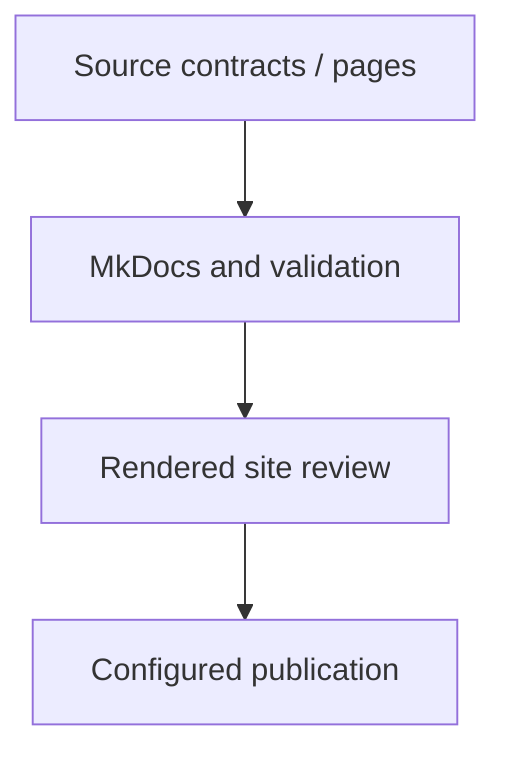

<a href="https://fireflysoftware.io/openplatform/">
<picture>
  <source media="(max-width: 640px) and (prefers-color-scheme: dark)" srcset="https://raw.githubusercontent.com/fireflysoftwaresolutions/.github/main/profile/assets/banner-narrow-dark.svg">
  <source media="(max-width: 640px)" srcset="https://raw.githubusercontent.com/fireflysoftwaresolutions/.github/main/profile/assets/banner-narrow-light.svg">
  <source media="(prefers-color-scheme: dark)" srcset="https://raw.githubusercontent.com/fireflysoftwaresolutions/.github/main/profile/assets/banner-dark.svg">
  
</picture>
</a>

# OpenPlatform Documentation

MkDocs documentation source for platform architecture, business journeys, repository reference, and adoption.

[Platform documentation](https://docs.fireflysoftware.io/) · [Source reference](docs/openplatform/reference.md) · [Source inventory](docs/openplatform/source-inventory.json)

## Purpose, scope, and readiness

Owns the public explanatory manual, brand-based responsive theme, reproducible diagrams, producer API snapshots and documentation checks. Internal acceptance cases, audits and execution registers remain outside public docs.

The repository contains site source and documentation workflows. Strict build, brand checks, rendered-page review, API/source parity, and published-site verification provide different evidence.

## Business ownership and supported journeys

Build the site locally, run its brand/link/contract checks, inspect rendered pages, and publish through the configured Pages workflow when authorized.

The site version and source release must agree. A diagram or documented journey does not establish product acceptance or live-provider readiness.

The supported surface is the repository artifact and its configured consumer commands. The setup and retained usage guide below identify the concrete entry points.

## Architecture and repository layout



Source and artifact directories: [docs](docs/), [hooks](hooks/), [scripts](scripts/), [sources](sources/), [theme](theme/).

## Contracts, data, authentication, and errors

The public surface consists of the files, commands, metadata, and consumer configuration defined by this repository. Preserve format/schema compatibility and exact consumer paths when changing generated assets or build inputs.

This repository is a tooling, documentation, configuration, or build artifact. Access control belongs to its repository, publishing destination, host integration, or consuming application. Keep credentials outside generated content and source-controlled examples.

The [security and failure reference](docs/openplatform/reference.md#security-and-failure-evidence) links local authorization annotations, status mappings, and exception sites. Framework or gateway policy is additional to this local inventory; verify the deployed filter chain and caller entitlements before integration.

## External dependencies, sandbox behavior, and replacement

External boundaries are the package registries, host integrations, publication targets, and consumer repositories used by the configured commands. Inspect those scripts before selecting a destination; no banking provider sandbox is implied.

Change an integration through the existing configuration or script contract, retain the same output format and validation gate, and exercise it on synthetic/local inputs before publishing. A successful local build does not establish remote installation or deployment.

## Configuration and local setup

Use a Python virtual environment and the checked-in requirements. Build and validate from the repository root:

```sh
python3 -m venv .venv
. .venv/bin/activate
python -m pip install -r requirements.txt
python -m unittest discover -s scripts/tests -v
python scripts/check_public_manual.py
mkdocs build --strict
python scripts/check_site.py
```

Read [maintenance tools](scripts/README.md) and [theme ownership](theme/README.md) before regenerating contracts or changing the layout. Run the configured full Markdown brand check, then inspect both themes, desktop/mobile, keyboard navigation, search, diagrams and the actual API explorer. Publication is a separate authorized operation.

The checkout contains **4 test source/resource files**. See the [test source index](docs/openplatform/reference.md#test-sources) for coverage locations. This inventory is not evidence that those tests passed.

CI definitions: [docs.yml](.github/workflows/docs.yml), [publish-gh-pages.yml](.github/workflows/publish-gh-pages.yml).

## Operations and recovery

Retain the original inputs and configured output/workspace paths. Inspect the failing command and its log, repair the prerequisite or configuration, and regenerate only the affected artifacts. Validate the actual consumer or rendered result after recovery; avoid resetting a user/client workspace to make a check pass.

## Compatibility and validation boundaries

Keep the artifact format, command arguments, dependency versions, and consuming toolchain aligned with the checked-in configuration. Verify the actual downstream consumer after a format, package, or integration change; local generation and remote adoption are separate results.

Documentation generation checks source freshness and local references. It does not certify compilation, test success, database migration safety, provider connectivity, regulatory approval, or end-to-end customer acceptance.

## Further reading, contribution, and license

- [Integrations and adapter replacement](docs/adapters/index.md)
- [Configure payment adapters](docs/adapters/payments.md)
- [Accounts API](docs/api/accounts.md)
- [Cards API](docs/api/cards.md)
- [Channel management API](docs/api/channel.md)
- [Producer API contracts](docs/api/contracts.md)
- [Distributor API](docs/api/distributor.md)
- [API and SDK contracts](docs/api/index.md)
- [Insurance API](docs/api/insurance.md)
- [Lending API](docs/api/lending.md)
- [Notifications API](docs/api/notifications.md)
- [Onboarding API](docs/api/onboarding.md)
- [Profile API](docs/api/profile.md)
- [Security API](docs/api/security.md)
- [core-banking-accounts](docs/api/services/core-banking-accounts.md)
- [core-banking-cards](docs/api/services/core-banking-cards.md)
- [core-banking-ledger](docs/api/services/core-banking-ledger.md)
- [core-banking-payments](docs/api/services/core-banking-payments.md)

Contributions should describe the affected business contract, update its tests and documentation together, and include the configured verification results. Review the source reference before changing public types or dependency boundaries.

No root LICENSE file is present. Consult the repository owner before redistributing its contents.

<!-- Maintained by .github/scripts/documentation/generate.py and curated.json. Edit editorial inputs, then regenerate. -->
