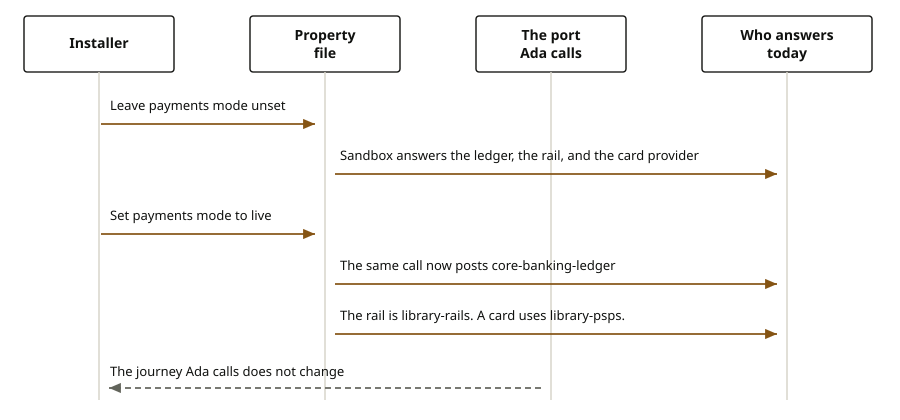

# Replace an adapter

Stewarded by the Firefly Software Foundation. <a href="mailto:dev@fireflysoftware.io">dev@fireflysoftware.io</a>

An installer does not rewrite Ada's journey to point at a new bank system. The journey calls a port. The port is a promise: hold this money, send this credit, say who this person is, evaluate this rules file, render this document. Which system keeps the promise is a property. One answer per port per deployment. The sandbox answer ships in the repository and does not open a network connection. The live answer is selected by configuration. Secrets stay out of the repository.

Ada's calls stay the same either way. She still signs in as `sample-journey`, tries a payment on agreement `10000000-0000-4000-8000-000000000021`, or asks for a quote. What changes is who posts the ledger, who sends the rail message, and who says she is signed in. She should not have to learn the new system.

## What she still sees

With every property left at the sandbox, a payment try returns a payment id and, for an outbound transfer, a numeric code. Confirm with that code posts in the sandbox book. The word sandbox is not the code. Sign-in still returns actor `11111111-1111-4111-8111-111111111111`. A decision that omits the score still sees 640 and, against the sample threshold 680, a referral. A document issue still returns HTML for the Horizon Personal Loan.

## Payments

`firefly.payments.mode` defaults to `sandbox`. The ledger hold and the later posting stay in memory. The rail and the card provider accept the instruction locally and do not send it. The numeric challenge is created by a stand-in for the strong-authentication core.

Set `firefly.payments.mode` to `live` and the same try and confirm post through `core-banking-ledger`. A credit transfer goes out through `library-rails`. International is SWIFT. A domestic transfer is SEPA when the catalog contains SEPA credit transfer. A card goes through `library-psps`. The challenge is created by `core-common-sca-mgmt`. Delivery of that code, in the wiring shipped here, still returns the code on the try response and does not send SMS, push, or email. An installer replaces that delivery.

`firefly.payments.configuration` defaults to `sandbox`. Set it to `live` when the routes, limits, currencies, and clearing accounts should be read from configuration and reference data instead of the sandbox lists.

## Identity, access, and the decision

`firefly.security-center.identity.adapter` defaults to `sandbox`. `sample-journey` is Ada. Set `keycloak`, `cognito`, or `internal-db` to use the matching Jafly provider. The journey does not construct that client.

`firefly.security-center.access.adapter` defaults to `sandbox` and reads `sandbox-access-policy.json`. Set `session-grants` when the check should use the role scopes on the party session. Replace the policy file to change who the sandbox allows. Do not hard-code allow and deny in a controller. `denied-actor` stays refused until that file grants him something.

`firefly.decision.credit-report` defaults to `sandbox` and returns score 640, not high risk, for every party. Any other value selects the report adapter the installer registers. The sandbox does not call a bureau.

`firefly.decision.ruleset` defaults to `openplatform-journey`. `firefly.decision.rulesets-directory` points at a directory of `{name}.yaml` files. Replacing the file changes approve, refer, and decline. It does not replace the engine.

## Catalog, documents, and the loan price

`firefly.reference-data.catalog.adapter` left unset uses the sandbox catalog. Deposits, payments, lending, and cards are regulated. Insurance is not. The document types are contract, amendment, renewal, letter, and welcome. Set the property to `core` to read reference data instead.

`firefly.documents.storage` defaults to the sandbox store. Set `core` to write the HTML, including the inlined kit stylesheet, into the document core.

`firefly.lending.price.adapter`, `firefly.lending.ledger.adapter`, and `firefly.lending.accounting.adapter` default to sandbox. The loan rate then comes from the product pricing configuration in that sandbox, the cash posting stays in memory, and the end-of-day journal stays in memory. Set them to the live values when the price, the ledger, and the general ledger should be the real services.

`firefly.experience.payments.adapter` defaults to `sandbox` for a loan disbursement. Set it to `hub` to try and confirm through the domain payments SDK. `firefly.terminal.adapter` defaults to the in-memory configuration. Set it to `domain` when a staff terminal should write through the domain services.

## What a refusal means

An unset property is the sandbox, not a failure. A live property with no address, or a provider process that is not running, fails the call that needs that system. The journey does not switch itself back to the sandbox. Ada sees the failure of that call. She does not see a silent fallback.

A rules file that is missing, or a catalog row that is missing, fails the decision or the document before the write. An international credit configured onto a card route is rejected. The rail is the path for that transfer.

## Reference

| Port | Sandbox until the property changes | Property |
| --- | --- | --- |
| Ledger, rail, card provider, challenge creation | In-process stand-ins | `firefly.payments.mode=live` |
| Challenge delivery | Returns the code, sends no message | Replace the delivery adapter |
| Routes and masters | Sandbox lists | `firefly.payments.configuration=live` |
| Identity | `sample-journey` is Ada | `firefly.security-center.identity.adapter` |
| Access | Policy file | `firefly.security-center.access.adapter` |
| Credit report | Score 640 | `firefly.decision.credit-report` |
| Rules | `openplatform-journey.yaml` | `firefly.decision.ruleset` |
| Catalog | Sandbox families and document types | `firefly.reference-data.catalog.adapter=core` |
| Document store | In-process HTML | `firefly.documents.storage=core` |
| Loan price, cash, and the day journal | In-process | `firefly.lending.price.adapter`, `firefly.lending.ledger.adapter`, `firefly.lending.accounting.adapter` |

The type names are the port interfaces behind those properties. They are the footnote. Ada's paths do not change.
