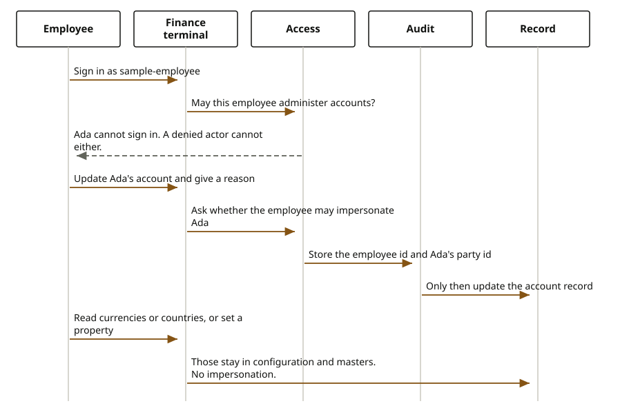

# Staff terminals

A staff terminal is a journey, kept apart from the public journeys. The employee signs in, the access check allows `IMPERSONATE`, and only then would the terminal act on a customer.

No finance staff terminal and no insurance staff terminal is on disk. The sequence stops at the access grant. It does not draw a domain call, because no experience service performs that operation.

## Steps

1. The employee calls `POST /api/v1/identity/subjects` on `domain-core-security-center` with username `sample-employee`. The sandbox adapter returns actor `33333333-3333-4333-8333-333333333333`. It does not start Keycloak.
2. The employee calls `POST /api/v1/access/checks` with action `IMPERSONATE` and resource type `PARTY`. The shipped policy allows that actor. `denied-actor` has no grants.
3. No terminal repository then calls a domain saga.

`domain-banking-accounts` and `domain-banking-cards` expose back-office read routes. Those routes are not this journey. They do not sign the employee in and they do not impersonate.

## Domain sagas and cores

None. There is no administration experience service to call one.

## Technical port

Identity and access are on [domain-core-security-center](https://github.com/fireflysoftwaresolutions/domain-core-security-center), port 8085. The property an installer changes is `firefly.security-center.identity.adapter`. The policy file is `sandbox-access-policy.json`.
