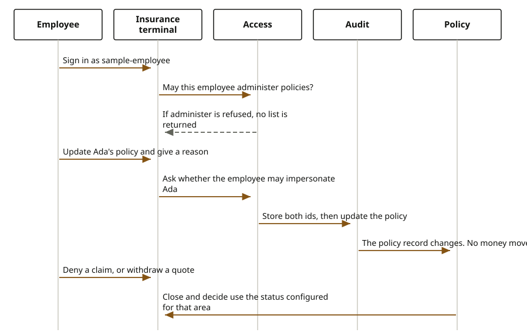

# Insurance terminal

An employee works policies, claims, and quotes without using Ada's insurance journey. The insurance terminal is that desk. Sign-in, administer, and impersonation are the same shape as the finance desk. The records are insurance records. This desk does not move money, and it does not certify IFRS 17 or Solvency II.

The employee is `sample-employee`, actor `33333333-3333-4333-8333-333333333333`. Ada is `sample-journey`, party `11111111-1111-4111-8111-111111111111`. She holds agreement `10000000-0000-4000-8000-000000000021`, the Horizon Personal Loan document, and she may also have a policy. The employee cannot change that policy until impersonation stores both ids. Ada cannot sign in on this desk.

Sign-in checks that the caller may administer. The sample policy anchor is `10000000-0000-4000-8000-000000000005`. If administer is refused, the employee gets no session, or, on a later list, no records. An unknown name is refused before that check returns a person.

Updating a policy sends Ada's party id and a reason. The terminal checks administer on the policy, then impersonate on her party. A refused impersonation does not change the policy. An allowed one writes an audit row with the employee id and her party id, then updates the policy. Closing a policy uses the configured status, which for a policy is cancelled. A claim can be closed, and a claim can be denied. A quote can be withdrawn, and a quote can be declined. Asking the policy area for a decision is refused, because a policy has no decide step on this desk.

<div class="ff-journey" markdown="0">

</div>

The employee can also list distributors, set a configuration value, and read currency and country masters. Those check administer and do not impersonate, because they are not a change to Ada's policy. When `firefly.terminal.adapter` is `domain`, configuration and reference data go through the domain SDKs for environment configuration and reference masters. The terminal does not call those two with its own HTTP client. The sandbox store remains the default until that property is set. Insurance still does not post the ledger. Any cash stays on the payments journey. Ada cannot open this terminal. Sign-in as `sample-journey` is refused.

## What the employee is refused

Ada and `denied-actor` do not receive a session.

An update without her party id or without a reason stops before the policy changes. Impersonation denied stops the update. Administer denied stops the list.

A claim decide is a denial. A quote decide is a decline. A policy decide is refused as not applicable. A master type other than currency or country is refused. A close whose status key is missing is refused.

## Where the records go

The audit row keeps the employee and Ada. The policy, claim, or quote stays in its own domain. With the domain adapter on, a policy update goes to the policies domain, a claim to the claims domain, and a quote to the underwriting domain. Those domains store the rows in their cores. They do not post money.

## Reference

The service listens on port 8121. The header after sign-in is `X-Actor-Id`.

| What the employee does | Call |
| --- | --- |
| Sign in | `POST /api/v1/staff/sessions` |
| List policies, claims, or quotes | `GET /api/v1/staff/records/{area}` |
| Update, naming Ada | `PUT /api/v1/staff/records/{area}/{recordId}` |
| Close | `POST /api/v1/staff/records/{area}/{recordId}/close` |
| Decide a claim or a quote | `POST /api/v1/staff/records/{area}/{recordId}/decide` |
| Set a property | `PUT /api/v1/staff/configuration/{key}` |
| Read masters | `GET /api/v1/staff/masters/{type}` |

```text
// POST /api/v1/staff/sessions
{ "username": "sample-employee" }

// PUT /api/v1/staff/records/POLICY/{recordId}
{
  // customerPartyId: 11111111-1111-4111-8111-111111111111
  // reason: why the employee is acting for Ada
}
```

There is no OpenAPI file for this terminal. Areas are `POLICY`, `CLAIM`, and `SUBMISSION`. A policy close looks for status `CANCELLED`. A claim close looks for `CLOSED`. A quote withdrawal looks for `WITHDRAWN`.
