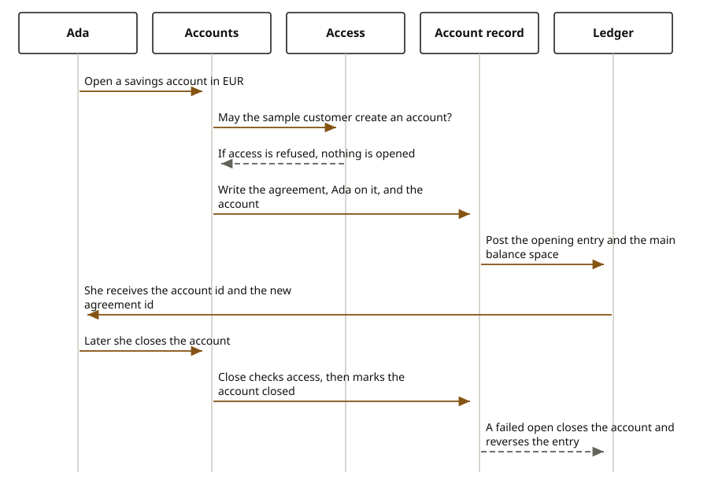

# Open and close an account

Ada Lovelace wants a place to hold money at the institution. Opening that place is its own sitting. It is not the card sitting, and it is not the loan sitting. The Horizon Personal Loan on agreement `10000000-0000-4000-8000-000000000021` stays that agreement. The account she opens is a new record, with its own agreement written as part of the opening.

She is `sample-journey`, party `11111111-1111-4111-8111-111111111111`. She asks for a savings account in EUR. The journey checks access as that sample customer before it writes anything. If she is not allowed to create an account, the domain is not called and she gets no account id.

When access allows it, the account domain writes the row in order. It creates an agreement, puts Ada on that agreement, creates the account, posts an opening entry on the ledger, and creates the main balance space. She sees an account id, the new agreement id, and the status completed. The account number, the type savings, the status active, and the currency EUR are what a later read of that account returns.

Closing is a separate call. Access must allow close on that account. The same account record is then marked closed. She does not call the contract journey herself. The agreement that was opened with the account is finished inside the account close.

She can also close a statement, set a withdrawal limit, and sweep money between two spaces of the same account. The accounts journey calls the accounts domain SDK for those three. It does not call the accounts core itself. The domain then calls the accounts core SDK, which stores the statement, the limit, and the sweep. The same journey stores a servicing mandate for her on the account, and it asks the payments domain SDK to run a standing order and to create a direct-debit mandate. The payments domain calls the payments core SDK, which stores those two and can read them back. The sample statement uses an opening balance and two lines. The sample limit and the sample sweep are separate amounts on that account.
Source: the sandbox statement opens at 100.00 USD with lines 25.00 and -10.00. The withdrawal limit is 50.00 USD. The sweep is 15.00 USD. The standing order is 25.00 GBP. The direct-debit limit is 100.00 GBP.

<div class="ff-journey" markdown="0">

</div>

There is a longer opening as well. She can start it, send proof of income, and name a funding source. The account itself is opened only after those waits. If a step after the open fails, the account that was just opened is closed. The direct open is the call that checks access and writes immediately. The published OpenAPI file lists the longer opening, the read, and the close. It does not list the direct open as its own operation, so the panel does not invent one.

## What she is refused

When access is not allowed, nothing is opened and nothing is closed. The ledger is not posted.

A currency that is not a three-letter code, or a missing party or product on the direct open, is rejected by the request before the domain runs. The sample she can send is party Ada, account type savings, and currency EUR.

If the open writes the agreement and the account and then a later part fails, the opening is undone: the account is closed and the opening ledger entry is reversed. She should not be left with a half-open account.

## Where the records go

The account row and its spaces live in the accounts core. The opening entry is a ledger posting, not a note on the account. The agreement id she receives is a contract record created for this account. It is not agreement `10000000-0000-4000-8000-000000000021`.

## Reference

The service listens on port 8100.

| What she does | Call |
| --- | --- |
| Open directly | `POST /api/v1/accounts` |
| Read one account | `GET /api/v1/accounts/{accountId}` |
| Read her accounts | `GET /api/v1/accounts/party/{partyId}` |
| Close | `DELETE /api/v1/accounts/{accountId}` |
| Close a statement | `POST /api/v1/account-records/accounts/{accountId}/statements` |
| Set a withdrawal limit | `POST /api/v1/account-records/accounts/{accountId}/limits` |
| Sweep two spaces | `POST /api/v1/account-records/accounts/{accountId}/sweeps` |
| Store a servicing mandate | `POST /api/v1/account-records/accounts/{accountId}/servicing-mandates` |
| Run a standing order | `POST /api/v1/payment-records/standing-orders` |
| Create a direct-debit mandate | `POST /api/v1/payment-records/direct-debits` |
| Start the longer opening | `POST /api/v1/journeys/account-opening` |
| Send income proof | `POST /api/v1/journeys/account-opening/{journeyId}/income-proof` |
| Name funding | `POST /api/v1/journeys/account-opening/{journeyId}/funding` |

```text
// POST /api/v1/accounts
{
  // partyId: 11111111-1111-4111-8111-111111111111
  // productId: the savings product
  // accountType: SAVINGS
  // currency: EUR
  // productCatalogId, roleInContractId, branchId: optional
}
// response
{
  // accountId
  // contractId: the agreement created with this account
  // status: COMPLETED
}
```

The type names are `OpenAccountRequest` and `AccountSummaryResponse`. The domain that writes the core is the accounts domain. The calls that the OpenAPI file lists are on the [accounts API](../../api/accounts.md).
