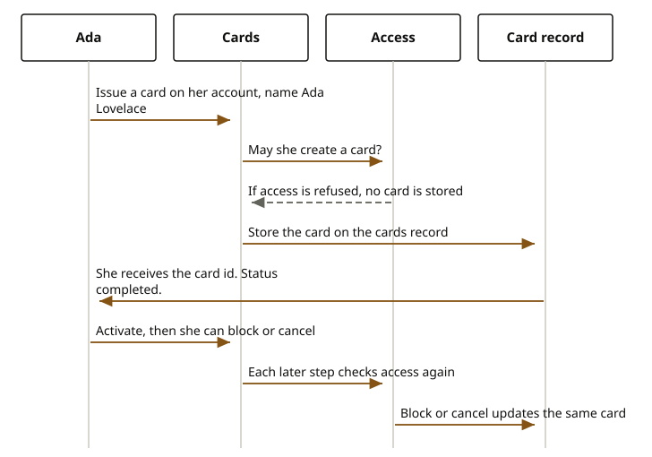

# Cards

Ada wants a card she can use on an account she already holds. Issuing that card is its own sitting. The card is tied to an account id, but opening the account is not this call, and moving money on the card is the payments sitting.

She is `sample-journey`, party `11111111-1111-4111-8111-111111111111`. The sample account resource used for access is `10000000-0000-4000-8000-000000000002`. She asks for a card on that account, with her name Ada Lovelace to emboss, and a card program. She can ask for a virtual card. The journey checks access as the sample customer before it stores a card. If she is not allowed to create a card, no card id is returned.

When access allows it, the cards domain stores the card. She sees a card id and the status completed. A later read can show a masked number, the card type, the status, and an expiry. Activate, block, and cancel are later calls. Each one checks access again. Activate and block update the card. Cancel closes it. A denial on any of those does not change the card.

<div class="ff-journey" markdown="0">

</div>

There is also a longer issuance. She starts it, confirms the address where a physical card should go, and sets a PIN. The card is issued after those waits, and then activated. If she is only asking for a virtual card on the direct issue, she does not go through that address and PIN wait.

A credit card can carry a line and a statement. Those rows live with the credit-card records the cards domain can call. A debit card does not need that line. The payments journey, not this one, is what posts a card movement on the ledger.

## What she is refused

When access is not allowed, the card is not issued, not activated, not blocked, and not cancelled.

A request that omits the customer, the account, or the card program is rejected before the domain runs. The sample she can send names Ada, the sample account, and the program.

## Where the records go

The card row is stored by the cards domain in the cards core. The account id on the card points at an account. It does not copy the account balance onto the card. Money still posts on the ledger, and only when a payment is confirmed.

## Reference

The service listens on port 8101.

| What she does | Call |
| --- | --- |
| Issue | `POST /api/v1/cards` |
| Read one card | `GET /api/v1/cards/{cardId}` |
| Read her cards | `GET /api/v1/cards/customer/{customerId}` |
| Activate | `POST /api/v1/cards/{cardId}/activate` |
| Block | `POST /api/v1/cards/{cardId}/block` |
| Cancel | `DELETE /api/v1/cards/{cardId}` |

```text
// POST /api/v1/cards
{
  // customerId: 11111111-1111-4111-8111-111111111111
  // accountId: 10000000-0000-4000-8000-000000000002
  // cardProgramId: the program
  // cardholderName: Ada Lovelace
  // virtual: true or false
}
// 201
{
  // cardId
  // status: COMPLETED
}
```

The type names are `IssueCardRequest` and `CardSummaryResponse`. The domain that stores the card is the cards domain. The operations are on the [cards API](../../api/cards.md).
