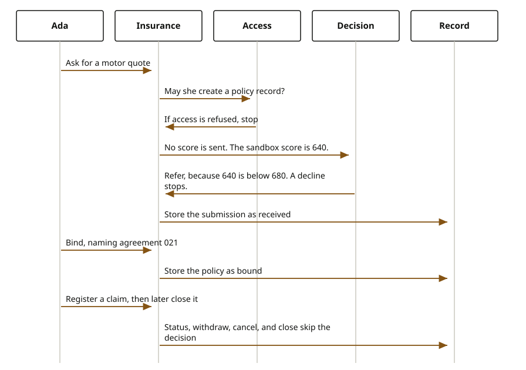

# Insurance

Insurance is one journey. A person asks for a quote, binds a policy, or registers a claim. Those are not three experience services. There is no `exp-insurance` repository on main, so nothing in `exp-*` sits in front of these calls. A channel calls the domain service for the task.

The picture has no Experience lifeline, because that service is not implemented. It shows the three writes the journey can make. A quote does not also register a claim. These domains do not move money and do not certify IFRS 17 or Solvency II.

## Steps

1. A quote calls `domain-insurance-underwriting`. `RegisterSubmissionSaga` creates the submission on `core-insurance-underwriting`. Compensation removes it.
2. A bind calls `domain-insurance-policies`. `RegisterPolicySaga` creates the policy on `core-insurance-policies`. Compensation removes it.
3. A claim calls `domain-insurance-claims`. `RegisterClaimSaga` creates the claim on `core-insurance-claims`. Compensation removes it.

Financials, delegated authority, reinsurance, and reserving are other insurance contexts. This journey does not call them.

## Domain sagas and cores

| Task | Saga | Core |
| --- | --- | --- |
| Quote | `RegisterSubmissionSaga` in `domain-insurance-underwriting` | `core-insurance-underwriting` |
| Bind | `RegisterPolicySaga` in `domain-insurance-policies` | `core-insurance-policies` |
| Claim | `RegisterClaimSaga` in `domain-insurance-claims` | `core-insurance-claims` |

## Technical port

No experience port is published for this journey. The domain services are [domain-insurance-underwriting](https://github.com/fireflysoftwaresolutions/domain-insurance-underwriting), [domain-insurance-policies](https://github.com/fireflysoftwaresolutions/domain-insurance-policies), and [domain-insurance-claims](https://github.com/fireflysoftwaresolutions/domain-insurance-claims).
