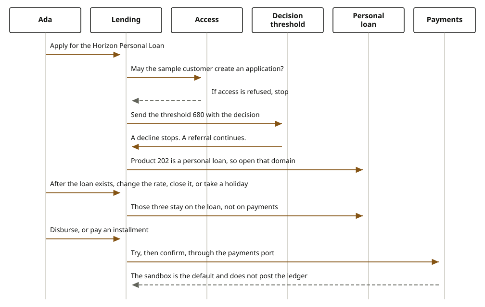

# Lending

Lending is one journey, `exp-lending`. The person simulates a product, applies, and later looks at the loan. The product kind chooses the saga. A personal loan, a lease, and a loan that is already disbursed are not three experience services.

The picture follows one loan through origination and then a servicing read. The same experience service also opens a lease or personal-loan terms. Those are other calls from this journey, listed under the picture, not other experience services.

## Steps

1. The person calls `POST /api/v1/experience/lending/applications` on `exp-lending`.
2. `AccessPort` must allow `CREATE` on `APPLICATION`. A denial does not continue.
3. `CreditReportPort` returns the sandbox report. It does not call a bureau.
4. The journey reads `journey.lending.min-credit-score` from `BusinessParameterPort` and sends that value with the decision. `DecisionPort` asks for `LENDING_APPLICATION`. A `DECLINE` does not call a domain.
5. The catalog selects the domain from the product kind. `LOAN_ORIGINATION` calls `LoanApplicationPort` on `domain-lending-loan-origination`. `PERSONAL_LOAN`, `MORTGAGE`, `ASSET_FINANCE`, and `SUPPLY_CHAIN_FINANCE` call `CreditProductPort`. `RegisterApplicationSaga` creates a loan application on `core-lending-loan-origination`. Compensation removes that application.
6. After the loan exists, the same journey reads it at `GET /api/v1/experience/lending/loans/{id}`. That call goes through `LoanServicingPort` to `domain-lending-loan-servicing` and `core-lending-loan-servicing`. A repayment on that domain is `AllocateRepaymentSaga`: `allocateRepayment`, compensation `restoreAllocation`.

A lease uses `POST /api/v1/experience/lending/asset-finance` and `domain-lending-asset-finance`. Personal-loan terms use `domain-lending-personal-loans`.

## Domain sagas and cores

| Product kind or task | Saga | Core |
| --- | --- | --- |
| Application | `RegisterApplicationSaga` in `domain-lending-loan-origination` | `core-lending-loan-origination` |
| Servicing, including a repayment | `AllocateRepaymentSaga` in `domain-lending-loan-servicing` | `core-lending-loan-servicing` |
| Lease or rental (`LEASING`, `RENTING`) | `RegisterAssetFinanceAgreementSaga` in `domain-lending-asset-finance` | `core-lending-asset-finance` |
| Personal-loan terms | personal-loan agreement saga in `domain-lending-personal-loans` | `core-lending-personal-loans` |
| Decision | `DecisionPort` in `domain-lending-credit-scoring`, not a lending aggregate | scoring rows stay on `core-lending-credit-scoring` |

## Technical port

[exp-lending](https://github.com/fireflysoftwaresolutions/exp-lending), port 8102. The decision HTTP call, when the sandbox adapter is replaced, is `POST /api/v1/decisions` with `journeyStep` `LENDING_APPLICATION`.
