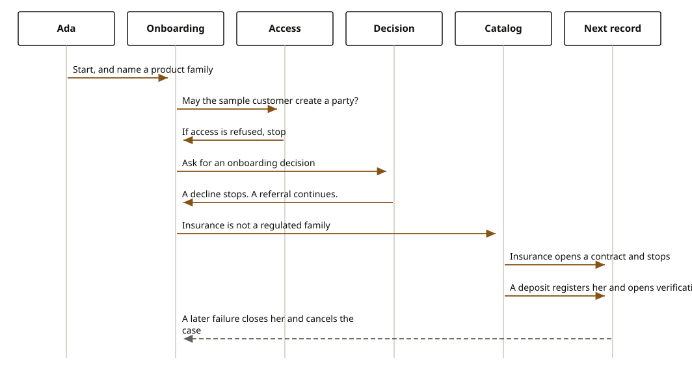

# Onboard a person or a company

A person, or a company, becomes a party. The person gives a name and an identity document. The company gives its registration and the people who own it. The same experience service runs both. A decline stops the journey before any saga writes.

## Steps

1. The person calls `POST /api/v1/onboarding/individuals`, or the company calls `POST /api/v1/onboarding/businesses`, on `exp-onboarding`.
2. `IdentityPort` resolves `sample-journey`. `AccessPort` must allow `CREATE` on `PARTY`. A denial does not start the workflow.
3. `CreditReportPort` returns the sandbox report. It does not call a bureau.
4. `DecisionPort` asks for `ONBOARDING`. A `DECLINE` does not register the party.
5. The workflow calls `domain-customer-people`. `RegisterCustomerSaga` runs `registerParty` on `core-common-customer-mgmt`. If a later step fails, compensation calls `removeParty`.
6. It then opens the case on `domain-customer-kyc-kyb`. A person uses KYC. A company uses KYB. `StartKybSaga` creates the case and compensation calls `cancelCase`.

After that, the person journey accepts personal data, economic data, identity documents, a KYC signal, and completion. The company journey accepts company data, beneficial owners, documents, authorized signers, a KYB signal, and completion.

## Domain sagas and cores

| Task | Saga | Core |
| --- | --- | --- |
| Register the person or the company | `RegisterCustomerSaga` in `domain-customer-people` | `core-common-customer-mgmt` |
| Open the case | `StartKybSaga` or the KYC case saga in `domain-customer-kyc-kyb` | `core-common-kycb-mgmt` |
| Welcome message | notification saga in `domain-common-notifications` | `core-common-notification-services` |

## Technical port

[exp-onboarding](https://github.com/fireflysoftwaresolutions/exp-onboarding), port 8096.

`firefly.experience.decision.adapter` stays on the sandbox decision adapter until a deployment sets `domain`. A later process engine can implement `DecisionPort`. It is not running now.
