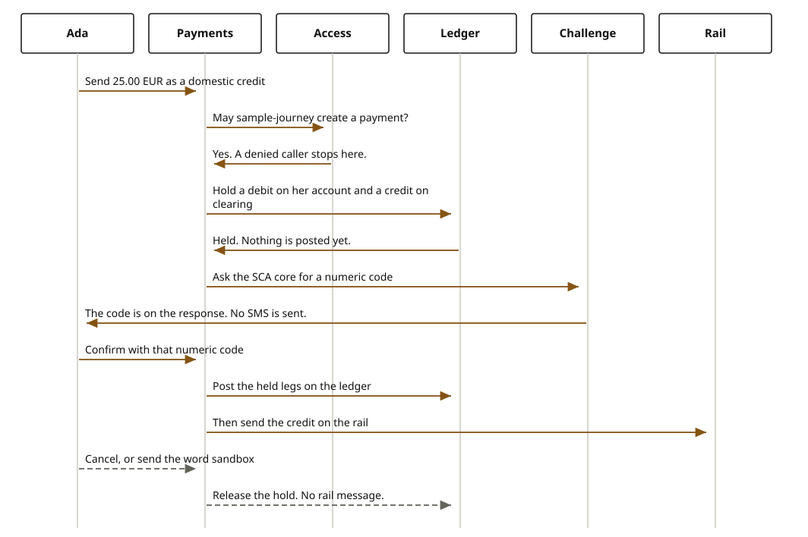

# Payments

A customer asks the bank to move money the bank holds. That sitting is its own journey. It is not a step inside opening an account, and it is not how an insurance premium is collected. Insurance does not move money. The ledger does.

The book of record is `core-banking-ledger`. Until the caller confirms, the money is only reserved. Confirm writes the ledger entry. For a credit that has to leave the bank, the rail is asked only after that entry exists. For a card, the payment service provider is asked instead of the rail. For money that arrives, the credit is accepted once and then posted once.

Ada Lovelace is signed in as `sample-journey`. Her actor id is `11111111-1111-4111-8111-111111111111`. The movement names the sandbox agreement `10000000-0000-4000-8000-000000000021`. In the published payment case the amount is the transfer, not the amount printed on the Horizon Personal Loan document.
Source: the payment case is 25.00 EUR. The loan document prints 250,000.00 EUR.

## Sending the transfer out

She asks to send the case amount from account `10000000-0000-4000-8000-000000000011` to a beneficiary, IBAN `DE89370400440532013000`. The scheme is a domestic credit transfer. The header `X-Firefly-Username` is `sample-journey`. If she omits it, the sandbox still treats the caller as `sample-journey`. If the header is `denied-actor`, the journey returns HTTP 403 and does not reserve anything.

The try places a hold. The ledger records two legs and does not post them: a debit of her account and a credit of the outbound clearing account. No rail message is sent. Because this is an outbound transfer, a numeric challenge is created. In the sandbox, a stand-in for the SCA core makes a six-digit code. When the deployment is live, `core-common-sca-mgmt` creates the operation and the code. Either way, the delivery shipped with this service puts that code on the try response. It does not send SMS, push, or email. The word `sandbox` is not the code.

She confirms by sending the numeric code back. Confirm posts the held legs on the ledger, and only then asks the rail to send the credit. A second confirm does not post again and does not send the rail again.

If she cancels while the payment is only reserved, the hold is released, the challenge expires, and no rail message is sent. Cancelling a payment that is already posted does not unwind it.

A domestic credit and an international credit both use the rail. International is SWIFT. When the catalog contains SEPA credit transfer, the domestic rail kind is SEPA. A card payout uses the payment service provider, and it asks for the same kind of code because it leaves the bank. An international transfer configured onto a card route is rejected.

<div class="ff-journey" markdown="0">

</div>

## Money she already holds

An internal transfer, including a move between spaces of the same account, does not challenge her. The setting that would demand a code for an internal movement is not present, so no code is created. Try still reserves the legs. Confirm posts them: from her source account to the other account, or from one space of an account to another space of that same account. Nothing is sent to a rail or to a card scheme. A space movement has to name a space type the catalog knows. The published case uses `SAVINGS`.

## Money arriving

A third party can credit her account `10000000-0000-4000-8000-000000000012`. A domestic credit that arrives on the rail is accepted once, matched by the third-party reference. Try asks the rail to accept the instruction, then holds a debit of the inbound clearing account and a credit of her account. She is not challenged. Confirm posts that hold. The same reference tried again returns the same payment and does not accept the instruction a second time. Confirming again does not post a second entry. A card credit follows the same once-only posting, and the provider that accepts it is the payment service provider, not the rail.

There is no separate international inbound scheme. An inbound domestic credit is the arrival the router registers.

## What she sees

On try she sees HTTP 201, a payment id, and phase `TRYING`. An outbound transfer or a card payout also shows a challenge id and a numeric code. An internal transfer, a space move, and an inbound credit do not show a code. On confirm with that code she sees phase `CONFIRMED` and the ledger posting. On cancel of a reserved payment she sees phase `CANCELLED` and no posting. A second confirm of the same payment does not add a second posting. The word `sandbox` does not confirm.

## Where the money goes

The book is `core-banking-ledger`. Try only holds. Confirm posts. An outbound credit debits her account `10000000-0000-4000-8000-000000000011` and credits the outbound clearing account, then the rail is asked. An inbound credit debits the inbound clearing account and credits her account `10000000-0000-4000-8000-000000000012`. An internal transfer debits one account and credits the other. A space move debits one space and credits another space of the same account. Insurance does not use this posting.

## What a refusal does

`denied-actor`, or any caller the sandbox does not entitle, is HTTP 403. The ledger is not touched.

Confirming with the word `sandbox`, or with any other value that is not the numeric code, rejects the challenge. The reservation is released. There is no posting, and the rail is not called.

If the rail refuses the outbound message after the ledger has posted, that posting is reversed.

A missing amount, a currency that is not three letters or not in the masters, a missing party, agreement, or payment method, an amount over the configured limit, or an unknown space type stops the try before a hold. An inbound credit without a third-party reference is refused. A cancelled payment cannot be confirmed.

## Reference

There is no OpenAPI file for this journey. The calls are on `POST /api/v1/payments`.

```text
// POST /api/v1/payments/tries
// header X-Firefly-Username: sample-journey
{
  // scheme: DOMESTIC_OUTBOUND, INTERNATIONAL_OUTBOUND, PSP_PAYOUT,
  //         INTERNAL_TRANSFER, SPACE_TRANSFER, RAIL_INBOUND, or PSP_INBOUND
  // idempotencyKey: string. An inbound credit uses thirdPartyReference instead.
  // amount: 25.00
  // currency: EUR
  // partyId: 11111111-1111-4111-8111-111111111111
  // contractId: 10000000-0000-4000-8000-000000000021
  // sourceAccountId: 10000000-0000-4000-8000-000000000011
  // destinationAccountId: required for an internal transfer and for an inbound credit
  // sourceSpaceId, destinationSpaceId, spaceType: a move between spaces
  // paymentMethodId: identifier
  // externalAccountName, externalIban, externalBic: the beneficiary on an outbound credit
  // thirdPartyReference: required on an inbound credit
}
// 201
{
  // paymentId: identifier
  // challengeId: present on an outbound transfer or a card payout, absent on internal and on inbound
  // challengeValue: the numeric code, not the word sandbox
  // phase: TRYING
}

// POST /api/v1/payments/{paymentId}/confirmations
{ "response": "the numeric code" }
// phase CONFIRMED, and the posting is present

// POST /api/v1/payments/{paymentId}/cancellations
// phase CANCELLED while the payment was only reserved
```

The type names behind the calls are `PaymentScheme`, `MovementRoute`, and the ledger, rail, card, and challenge ports. `firefly.payments.mode=live` selects `core-banking-ledger`, `library-rails`, `library-psps`, and `core-common-sca-mgmt`. The default is sandbox.
