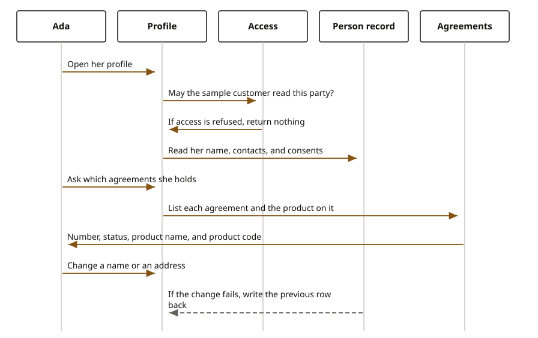

# Profile

The signed-in person reads who she is and which agreements she holds. She can correct a name, a phone, an address, a consent, or an identity document. She cannot open an account here, and she cannot move money here. Contracts on the profile are a read from the contract service, then a read of the product named on each contract. The profile does not open the contract tables itself.

Ada Lovelace is `sample-journey`, party `11111111-1111-4111-8111-111111111111`. She asks for her profile, and she asks for her agreements. The sandbox agreement `10000000-0000-4000-8000-000000000021` appears in that list when the contract service holds it for her. The profile does not invent the row. When the row is there, she sees the contract id, the contract number, the status, when it was signed, and the product id, name, and code. The Horizon Personal Loan document is the reading copy of that agreement. The profile is the list.

Every read and every change checks access as `sample-journey`. She must be allowed to read, or to update, the party. If she is not, the person service and the contract service are not called.

A change of personal data reads the current row, writes the new one, and keeps the previous row aside. If a later step of that change fails, the previous row is written back.

<div class="ff-journey" markdown="0">

</div>

## What a refusal does

When access is not allowed, the call returns no profile and no agreements. An update is not attempted.

The check is made as `sample-journey`. In the sandbox policy that actor may read and update the sample party. A policy that does not grant her stops the call before either service.

A contract the contract service does not have for her is simply absent from the list. The profile does not answer with an empty product in its place. If the product named on a contract cannot be read, that agreement still comes back with the contract fields and without a product name.

## Reference

The service listens on port 8103. The party id is in the path.

| What she does | Call |
| --- | --- |
| Read herself | `GET /api/v1/experience/profile/{partyId}` |
| Change personal data or contact data | `PATCH .../personal-data` or `.../contact-data` |
| Addresses | `GET`, `POST`, `PUT`, `DELETE .../addresses` |
| Consents | `GET .../consents` and `PUT .../consents/{id}` |
| Identity documents | `GET`, `POST`, `DELETE .../identity-documents` |
| Agreements | `GET /api/v1/experience/profile/{partyId}/contracts` |

```text
// GET /api/v1/experience/profile/11111111-1111-4111-8111-111111111111/contracts
// each item
{
  // contractId: 10000000-0000-4000-8000-000000000021 when that agreement is hers
  // type: the contract number
  // status: the contract status
  // signedAt: when it was signed
  // productId, productName, productCode: the product on that agreement
}
```

The JSON property for the contract number is `type`. The type names are `ContractSummary` and the party profile port. Full terms stay on the contract service. The calls are also on the [profile API](../../api/profile.md).
