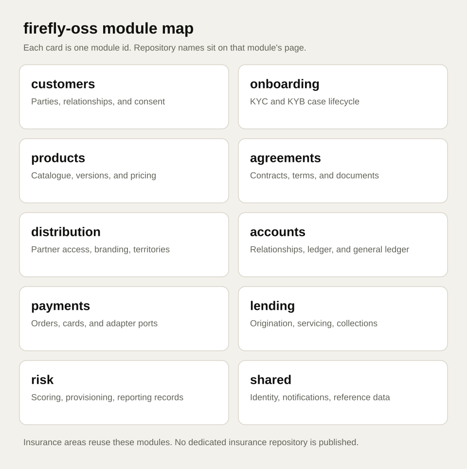

# OpenPlatform

  
Firefly Software · Developer hub

  
OpenPlatform

  
Composable banking and insurance modules on one open foundation.

  
APIs, events, and adapters so institutions assemble journeys without replacing every system they already run. This hub is for people who build, integrate, and operate on the platform.

  
Attitude makes the difference.

  <ul class="ff-hero__actions">
    <li><a class="ff-hero__primary" href="start/prerequisites/">Start here</a></li>
    <li><a href="architecture/overview/">Architecture</a></li>
    <li><a href="modules/catalog/">Business modules</a></li>
    <li><a href="versioning/bom/">BOM 26.10.19</a></li>
  </ul>

<ul class="ff-pins" markdown="0">
  <li class="ff-pin">
    Jafly / Central
    26.10.19
  </li>
  <li class="ff-pin">
    Spring Boot
    4.1.1
  </li>
  <li class="ff-pin">
    Java
    25
  </li>
  <li class="ff-pin">
    Publish status
    Central live
  </li>
</ul>

OpenPlatform modules live under **firefly-oss**. Industry products such as
**LendingOS** sit on top under **firefly-serviceOS**. Both trains inherit
Jafly **26.10.19** (Spring Boot **4.1.1**, Java **25**) from Maven Central.

## Choose a path

  <article class="ff-path">
    
New service

    
<a href="start/prerequisites/">Start here</a>

    
JDK 25, resolve the parent chain, then mirror a neighbour repository for your first Jafly service.

  </article>
  <article class="ff-path">
    
Shape of the platform

    
<a href="architecture/overview/">Architecture</a>

    
Experience, domain, and core bands; adapters at the boundary; how orgs and products relate.

  </article>
  <article class="ff-path">
    
Catalogue

    
<a href="modules/catalog/">Business modules</a>

    
Customers, onboarding, products, agreements, distribution, accounts, payments, lending, and risk.

  </article>
  <article class="ff-path">
    
Outside Firefly

    
<a href="integrate/adapters/">Integrate</a>

    
Adapter pattern plus guides for payment rails and PSP libraries.

  </article>
  <article class="ff-path">
    
Contracts

    
<a href="reference/">Reference</a>

    
OpenAPI and event-contract indexes drawn from repositories — no invented endpoints.

  </article>
  <article class="ff-path">
    
Pins

    
<a href="versioning/bom/">Versioning and BOM</a>

    
Authoritative 26.10.19 / Boot 4.1.1 pins, Central preference, and mike aliases.

  </article>

## Platform status

As of 2026-10-18/19 the OpenPlatform Java train inherits Spring Boot
**4.1.1** through `com.firefly:firefly-parent` and
`org.fireflyframework:fireflyframework-parent` version **26.10.19**. That
release is on **Maven Central** (and GitHub Packages). Prefer Central;
use `-Pjafly-packages` only when Central is unreachable.

Framework docs for Jafly:
<https://fireflyframework.github.io/fireflyframework-jafly/>

See <a href="versioning/bom.md">Versioning and BOM</a> for the full picture,
and <a href="ecosystem.md">Ecosystem</a> for how products and orgs relate.

## Related surfaces

- This hub: <https://docs.fireflysoftware.io/>
- Product site: <https://fireflysoftware.io/openplatform/>
- Brand kit: <https://github.com/firefly-oss/brand-kit>
- Framework reactor: <https://github.com/fireflyframework/fireflyframework-jafly>
- Jafly docs: <https://fireflyframework.github.io/fireflyframework-jafly/>
- Improve these pages: <a href="contribute/index.md">Contribute</a>
