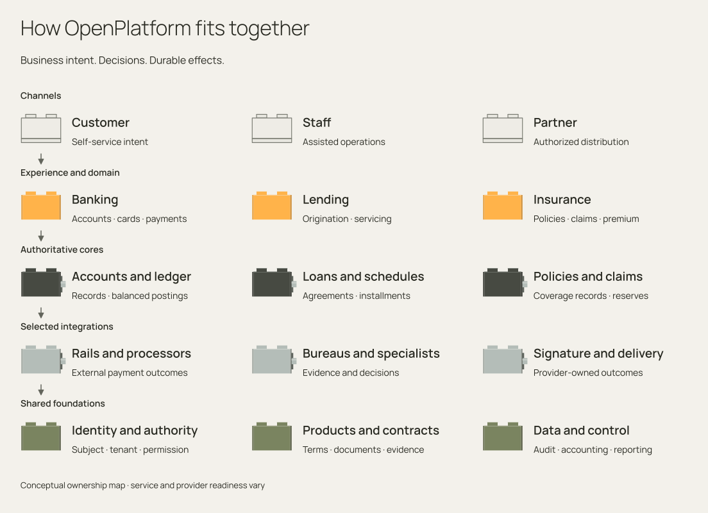

# OpenPlatform

Understand, build, and operate banking and insurance journeys.

OpenPlatform organizes financial services into customer and staff experiences, business domains, and authoritative cores. Its SDKs connect these boundaries; Jafly supplies the application infrastructure; replaceable adapters connect external systems. This manual explains how those pieces work together, how data and money move, and how an operation recovers when a participant fails.

<figure class="ff-platform-map">
<picture>
  <source media="(max-width: 640px) and (prefers-color-scheme: dark)" srcset="assets/diagrams/platform-landscape-narrow-dark.svg">
  <source media="(max-width: 640px)" srcset="assets/diagrams/platform-landscape-narrow-light.svg">
  <source media="(prefers-color-scheme: dark)" srcset="assets/diagrams/platform-landscape-dark.svg">
  
</picture>
<figcaption>Customer and staff experiences coordinate domain decisions; owning cores retain business records and money; selected adapters reach external authorities. Shared identity, terms, and evidence span each journey.</figcaption>
</figure>

## Start with the platform

The [introduction](introduction/index.md) explains what OpenPlatform contains, who uses it, and how to read its architecture. Follow the [platform map](introduction/platform-map.md), then the [execution model](introduction/execution-model.md), and [data and money](introduction/data-and-money.md). These chapters establish the vocabulary used throughout the business and implementation guides.

A customer request, a business decision, a stored record, and a settled financial effect are different things. For example, a transfer can have an accepted instruction, a reservation, ledger postings, a provider reference, and a later settlement result. A policy can have an underwriting decision, accepted terms, an effective contract, premium obligations, claims, and financial adjustments. The manual follows those relationships instead of treating every record API as a complete journey.

## Explore the business lifecycles

### Operational banking

[Accounts, cards, payments, and open banking](journeys/banking.md): eligibility and opening, ownership, restrictions, balances and reservations, issuance and authorization, clearing and settlement, disputes, consent, servicing, reconciliation, repair, and closure.

### Lending

[Origination through servicing and recovery](journeys/lending.md): applicant and bureau evidence, pricing, underwriting, collateral, signed terms, disbursement, schedules, repayment allocation, restructuring, collections, provisioning, and accounting.

### Insurance

[Distribution through claims and financial close](journeys/insurance.md): quote, underwriting authority, bind, endorsements, renewal, premium, commissions, claim coverage and settlement, reserves, reinsurance, delegated authority, and reconciliation.

### Shared capabilities

[Identity, customer, product, contract, and controls](journeys/shared.md): trusted caller context, evidence and consent, versioned terms and decisions, documents and signatures, notifications, configuration, reference data, audit, and operating authority.

## Follow an operation through the layers

The **experience** receives business intent and presents its outcome to a customer, employee, or channel. The **domain** enforces business decisions and coordinates participants. The **core** owns validated durable state and local transactions. SDK contracts describe the handoffs; integration ports describe how a selected sandbox or provider participates.

Read [architecture](layers/index.md) for these responsibilities and [Jafly](jafly.md) for CQRS, sagas, TCC, transactions, and security infrastructure. Use [integrations](adapters/index.md) to understand provider capability, lifecycle, provenance, and replacement. A sandbox implements the same port with explicit synthetic scenarios; it does not turn missing external behavior into successful business work.

## Implement and operate with evidence

[Get started](quickstart.md) takes you from a business outcome to the responsible repositories, prerequisite data, exact producer SDK, isolated environment, and executable boundary. The [API directory](api/contracts.md) exposes experience, domain, and core contracts with operation lists and source digests. The [repository map](reference/repositories.md) leads to each service's setup, examples, configuration, source, and tests.

[Operate](operations/index.md) explains duplicate instructions, lost responses, uncertain provider outcomes, partial financial failure, restart, compensation, and data repair. Each journey must retain its original action and authoritative effect IDs so recovery can determine what already happened before retrying.

## Choose your reading path

Use the [reading paths](introduction/reading-paths.md) to choose a sequence for business analysis, implementation, integration, or operations. Keep the [glossary](introduction/glossary.md) nearby when moving between financial, insurance, and engineering terminology. Each capability guide explains its current behavior, configuration, dependencies, limitations, and recovery procedure.
