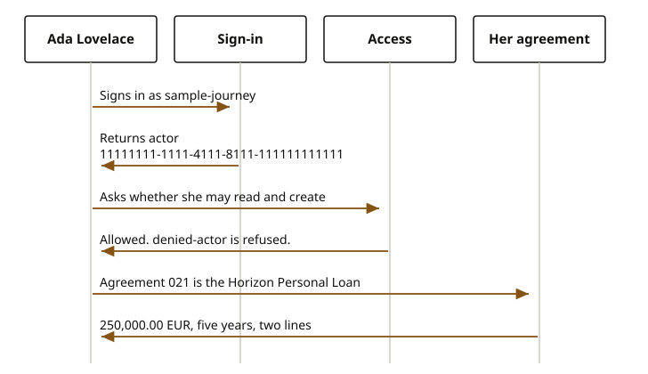

# Presentation

OpenPlatform is the open-source project of the Firefly Software Foundation and Firefly Software Solutions Inc. They stay two bodies. The Foundation stewards the project. The company stands behind it. Contact remains the Firefly Software Foundation, [dev@fireflysoftware.io](mailto:dev@fireflysoftware.io).

It is a set of corporate systems for enterprise industries. Banking and insurance come first. Another industry can use the same shape later: a journey a person follows, a domain port that does one job, and a core that stores the rows. The institution runs the software. The data stays in the cores. A process engine, a payment rail, a card provider, or an identity service replaces an adapter. The journey does not change when that adapter changes.

Jafly is the framework the services are built with. It is the Java framework from Firefly Framework. OpenPlatform does not ship a second copy of it. The published documentation is version 26.10.3.

## One afternoon with Ada

The person in every chapter is Ada Lovelace. She signs in as `sample-journey`. That name resolves to actor `11111111-1111-4111-8111-111111111111`. She may read and create the sample resources. The username `denied-actor` is refused, and a refused caller never reaches a record.

The agreement that follows her is `10000000-0000-4000-8000-000000000021`. The document that prints it is a Horizon Personal Loan, five years, two lines. That page is a reading copy. It is not a movement of money.
Source: the sandbox sample prints 250,000.00 EUR.

What she sees first is her actor id and the provider name sandbox. No password is read, and no identity-provider process starts.

If she is new and names insurance, onboarding opens a contract and does not start an identity case. Insurance is not a regulated banking family. If she names deposits, cards, lending, or payments, onboarding registers her and waits for identity evidence. That split is [onboarding](experience/public/onboarding.md).

Once she exists, [profile](experience/public/profile.md) lists the agreements the contract service holds for her. When agreement `...021` is among them, she sees its number, its status, and the product name Horizon Personal Loan.

If she sends money, that is [payments](experience/public/payments.md). A domestic or international credit is reserved, she receives a numeric code, and only that code posts the ledger and then sends the rail. The word sandbox is not the code. An internal move, including a move between spaces of one account, posts the ledger and does not ask for a code. Money arriving from outside is accepted once and posted once. Cancel, while the money is only reserved, releases the hold.

If she wants cover, that is [insurance](experience/public/insurance.md). She asks for a quote, binds a policy, and registers a claim. Later she can change a status, withdraw the quote, cancel the policy, or close the claim. Endorse and renew are not on that journey. Insurance does not move money and does not certify IFRS 17 or Solvency II.

If she asks for the Horizon Personal Loan, that is [lending](experience/public/lending.md). The product chooses the record. After the loan exists she can read the amortization calendar and, when the loan is syndicated, the facility. She can change the rate, close the loan, or take a payment holiday. Paying the money out tries, then confirms.

An employee who acts for her uses the finance terminal or the insurance terminal. Those desks are not her journey. They require administer, and a change in her name stores the employee id and her party id before the record changes.

## Where the records go

A person row lives in the customer core. An agreement lives in the contract core. An account lives in the accounts core, and its opening entry is a ledger posting. A card lives in the cards core. A loan lives in the lending cores the product route names. A policy, a claim, and a quote live in the insurance cores. A printed contract is HTML in the document store. Money the bank holds is posted on `core-banking-ledger`, and only when a payment is confirmed.

## Where to go next

- [Start here](quickstart.md) for this path as calls, and what each response shows.
- [Jafly](jafly.md) for sign-in and the decision.
- [Replace an adapter](adapters/index.md) for the edges an installer swaps.
- [Service landscape](layers/bian.md) and [insurance standards](layers/acord.md) for the coverage maps.
