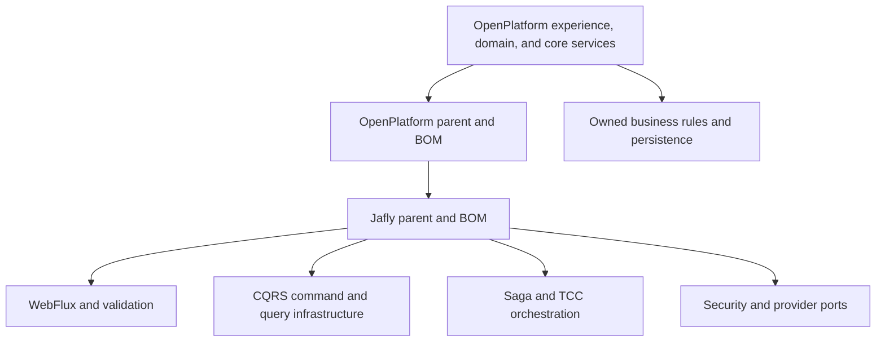

# Jafly and the application architecture

Jafly is the Java framework used by OpenPlatform services. It provides infrastructure for HTTP, validation, security integration, command/query handling, orchestration, transactions, integration ports, and observability. OpenPlatform supplies the institution-facing business capabilities and the authoritative banking and insurance records.

## How the dependencies fit

The remote source baseline uses `io.fireflysoftware:firefly-parent:26.10.6`, extending Jafly 26.10.20. The current working parent selects `org.fireflyframework:fireflyframework-parent:26.10.22` and its matching BOM centrally. This working train is installed only in the isolated development cache and has not been published. Check the effective POM and actual packaged dependencies for each consumer; changing a parent does not rebuild an existing SDK or service. [Operating guidance](operations/index.md) explains version and deployment checks.

The [framework and SDK adoption tutorial](reference/service-guides/framework-adoption.md) walks through effective dependencies, clean source builds, executable inspection, client compatibility, current authority and complete private service-chain verification. It also explains why skipped tests, stale generated classes and a parent version are insufficient evidence.

## CQRS: express the decision being requested

Commands name a business change, carry validated intent and stable correlation, and return an outcome the caller can interpret. Queries read state without authorizing a write. The command bus does not supply missing eligibility, resource ownership, money precision, or permission rules. Those belong to the responsible business service and its owning core constraints.

Use existing handlers and contracts. A missing command result must not be translated into an invented created UUID or successful HTTP status. Verify actual saga result keys and persisted identifiers at the SDK boundary.

Query caching requires a deliberately scoped key. In the current Jafly working train, `Query.getCacheKey()` returns `null` by default: a class name or metadata hash cannot distinguish every requested resource and authority scope. Custom keys must cover all result-affecting inputs and relevant trusted tenant/subject/policy context. Both query-bus overloads honor `@QueryHandlerComponent(cacheable = false)`. Keep authoritative status/result reads uncached unless their freshness and invalidation policy is explicitly implemented; a cached result must never substitute another request's identifiers.

## Sagas: coordinate recoverable steps

A saga composes steps that cannot share one database transaction. Each step needs a durable effect identity, a retrievable outcome, and a defined response to retry and uncertainty. Compensation is a business operation: a posted ledger effect gets a linked reversal, an accepted provider request needs its supported cancellation protocol, and retained signature evidence must not be deleted to simulate rollback.

A saga's successful terminal label proves only what its executed steps prove. If the process state exists only in memory, restart and cross-instance recovery remain unqualified. The [operating guide](operations/index.md) defines the required failure and recovery cases.

## TCC: define the promise before confirmation

Try, confirm, and cancel are participant contracts. A valid try identifies what was reserved, who owns that reservation, its expiry, and how a repeated request recovers it. Confirm consumes that same promise once. Cancel releases an eligible unconsumed promise. A PENDING posting row does not by itself prove spendable funds were reserved.

After external acceptance, timeout means uncertain outcome until lookup or reconciliation establishes finality. Do not call compensation merely because a transport response was lost.

## Transactions: keep atomic work inside its core

Use the owning core's database transaction for invariants that must commit together. Ledger header, legs, and history cannot be made atomic by issuing several independently committed HTTP writes from a domain. Foreign-context writes remain SDK operations with explicit orchestration and recovery.

Jafly 26.10.22 also makes its R2DBC infrastructure conditional on the relevant classes and connection-factory candidate. A database-free domain can use a library with transitive database contract types without inventing a database connection. Database services still configure the real connection and native Boot infrastructure. A custom reactive transaction manager is retained. When a service has several connection factories, explicitly choose the intended infrastructure rather than assuming one global database manager represents every store.

## Exact JSON schemas at document boundaries

The Jafly validators module now contains the shared `OfflineJsonSchemaValidator` mechanism. Masters uses it for document-template input schemas; the financial meaning, publication authority, template selection, and immutable revision belong to OpenPlatform. Keep reusable parsing and schema diagnostics in the framework and business publication rules in the owning core.

The API accepts JSON strings and returns immutable validation issues without exposing the underlying JSON vendor types. Pass the exact schema and instance strings when decimal precision matters: converting an 18-decimal constraint through a generic floating-point map can change its value before the validator sees it. Empty input is invalid JSON. A JSON null remains an actual JSON value subject to the selected schema.

This is a restricted Draft 2020-12 profile. It requires an object schema with an explicit supported dialect, bounds caller input and diagnostics, rejects external references and cyclic references, and permits local JSON-pointer references only to recognized schema positions. Literal `const`/`enum` data is preserved during compilation. The conservative profile can reject unsupported reference-like content in annotations; it is not an unrestricted schema-conformance implementation. Input bounds also do not establish an execution-time deadline for arbitrary patterns or combinatorial schemas.

For authoring and publication, validate the schema itself before storing or publishing it. For generation, resolve the exact published revision and validate the exact authoritative document facts against that revision. Preserve canonical schema/source strings and their digests through SDKs; an inspection map is not a lossless authoring contract. The validators module's `docs/offline-json-schema-validation.md` documents the exact supported profile and limits.

## Security and decisions

Provider adapters establish identity through the framework's supported interfaces. Trusted subject, issuer, tenant, scope, and resource authority must reach the business operation. A supplied username, party ID, or tenant header is not authentication.

The rules engine evaluates configured facts and rules. Preserve evidence/model/rule versions and distinguish APPROVE, REFER, DECLINE, pending, and unavailable outcomes. A referral needs authorized resolution. A constant synthetic report is an executable fixture, not a real underwriting result.

The resource-server module supplies reusable access-token validators requiring expiration and, when selected, exact issuer/audience checks. Signature verification still belongs to the configured decoder. Background OAuth clients need actual native registrations and current credentials; project overrides must replace default providers without bean-order ambiguity. A current principal must carry the signed tenant/resource attributes required by the product operation; an arbitrary request header cannot supply them.

## Integration ports and replacement

Reuse the correct framework port instead of duplicating provider infrastructure. A signature envelope interface and a signature request interface provide different capabilities. A payment rail acceptance and settlement response have different meaning. The [adapter guide](adapters/index.md) explains typed translation, durable provider identity, explicit sandboxes, and replacement qualification.

## What to verify in a service

Read its effective dependencies, configuration, selected beans, command/query handlers, orchestration persistence, transaction manager, security filter ordering, SDK producers, and failure mapping. Execute the real producer and its private database before claiming persistence or wire parity. Then qualify the full business chain and external provider separately.

Framework documentation and modules: [Firefly Framework](https://fireflyframework.org/frameworks/java/) and the [Jafly source](https://github.com/fireflyframework/fireflyframework-jafly). OpenPlatform-specific behavior remains documented in the owning repository and [business journeys](journeys/index.md).
