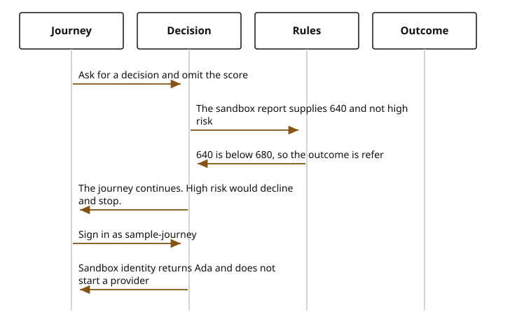

# Jafly

Stewarded by the Firefly Software Foundation. <a href="mailto:dev@fireflysoftware.io">dev@fireflysoftware.io</a>

Jafly is the Java framework in [Firefly Framework](https://fireflyframework.org). The Foundation maintains the frameworks. Firefly Software Solutions Inc. builds services on them. They stay two bodies. OpenPlatform does not ship a second copy of Jafly, and it does not fork the rules engine or the identity adapters.

On the framework site, Jafly is the layer between Spring Boot and the business rules. Requests stay on Spring Boot and WebFlux. Jafly adds modules a service takes as it needs them: command and query buses, orchestration for compensating steps and for try-confirm-cancel, reactive transactions, and observability. The current framework release uses Java 25 and Spring Boot 4.1.1. The team still owns the business rules, the permission decisions, and what a failed step undoes. The framework does not make a command exactly once.

OpenPlatform 26.10.3 sits on that foundation. `firefly-parent` 26.10.3 extends `org.fireflyframework:fireflyframework-parent` 26.10.20 and imports `org.fireflyframework:fireflyframework-bom` 26.10.20. Every OpenPlatform module inherits that pin. Jafly's own book and module guide are at [fireflyframework.org/frameworks/java](https://fireflyframework.org/frameworks/java/).

## What Ada meets

Ada never calls Jafly by name. She signs in, and she sometimes waits for a decision.

Sign-in is the security center. With the identity adapter left at `sandbox`, the name `sample-journey` returns her actor id and does not start Keycloak, Cognito, or an internal user store. The password is ignored. An installer sets the same property to `keycloak`, `cognito`, or `internal-db`. Those three are Jafly identity adapters. The journey still does not open an identity-provider client of its own. The security center is the service that selects the provider.

A decision is the credit-scoring service. The sample rules file is `openplatform-journey`. The threshold in that file is 680. When a journey does not send a score, the sandbox report supplies 640 and says the party is not high risk. 640 is below 680, so the outcome is a referral, reason `CREDIT_SCORE_BELOW_THRESHOLD`. A referral does not stop the journey. High risk is a decline, reason `HIGH_RISK`, and a decline does not write the record. An installer replaces the rules file, or points `firefly.decision.rulesets-directory` at a directory of files. The installer does not replace the engine that evaluates the file.

Payments use the same foundation for a different pause. Try reserves the money. Confirm is a later call, after Ada returns the numeric code. That pause is why try and confirm are separate calls. The payments chapter tells that story. This page does not.

## What can go wrong

An unknown username is not a subject. The sandbox returns an empty result, and the security center answers HTTP 404. A body with neither username nor actor id is HTTP 400.

A decline stops the journey before the domain write. A missing score, when the sandbox cannot fill one, is a referral for missing credit attributes, and the journey still continues.

If the identity property is set to a provider and that provider is not running, sign-in fails in that provider. The sandbox setting does not require the provider process.

## Reference

| Piece | Where it sits |
| --- | --- |
| Parent | `io.fireflysoftware:firefly-parent` 26.10.3 |
| Framework parent and bill of materials | `org.fireflyframework` 26.10.20 |
| Decision call | `POST /api/v1/decisions` |
| Outcomes | `APPROVE`, `REFER`, `DECLINE` |
| Rules file | `rulesets/openplatform-journey.yaml`, name `firefly.decision.ruleset` |
| Identity property | `firefly.security-center.identity.adapter` |
| Credit report property | `firefly.decision.credit-report`, default `sandbox` |

The type names are `DecisionPort`, `JaflyRulesEngineAdapter`, and `SandboxIdentityAdapter`. They are the footnotes. The page above is the behavior.
