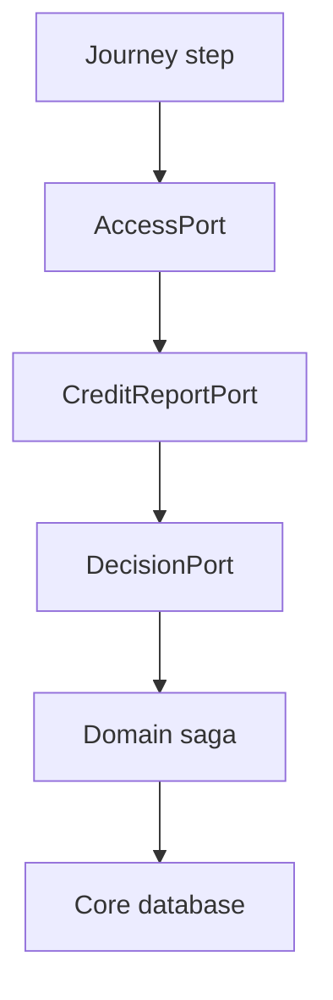

# Architecture

A customer action moves in one direction. Experience owns the journey. Domain owns the saga. Core owns the database. Libraries are shared code, not a fourth place where records live.

Read the boxes against what main actually contains.

`DecisionPort`, `CreditReportPort`, and `JaflyRulesEngineAdapter` are in `domain-lending-credit-scoring` on main. `POST /api/v1/decisions` is the HTTP adapter. `SandboxCreditReportAdapter` supplies the report and does not call a bureau. The rules engine is Jafly's `org.fireflyframework.rules.core.dsl.evaluation.ASTRulesEvaluationEngine`, from BOM `26.10.20`. OpenPlatform does not ship a forked engine.

`AccessPort` is not in the published experience modules and not in the published security center. Do not call a sandbox access endpoint. The diagram shows where that check belongs when it is published: before the report and the decision. A denied check must not call the domain.

The domain saga then writes one core through that core's SDK. It does not import another core's internals. Cross-service links are UUIDs. Child rows inside one core cascade on delete. Currency is `VARCHAR(3)`.

## A process engine later

An experience step calls a port. The default adapter calls a domain service. A later process engine can implement that same port. This train does not run that engine. No diagram here shows one in the call path.

## Keycloak is not a journey call

`domain-core-security-center` depends on `org.fireflyframework:fireflyframework-security-idp-keycloak`. That module is a Jafly identity-provider adapter, BOM `26.10.20`. The journey does not construct a Keycloak client. On main, `firefly.idp.provider` and `firefly.security-center.idp.provider` are `cognito`. An installer changes those properties. The decision call does not read them.

Jafly (`org.fireflyframework`, BOM 26.10.20) is the framework under this train. OpenPlatform does not fork it. See [Jafly](../jafly.md).

## Open a layer

- [Experience](experience.md). The nine `exp-*` services.
- [Domain](domain.md). The saga rule and every `domain-*` service.
- [Core](core.md). Persistence rules and every `core-*` service.
- [Libraries](libraries.md). Payment ports, batch jobs, the parent, and the bill of materials.

The same repositories, grouped by business, are the [families](../catalog/index.md).
