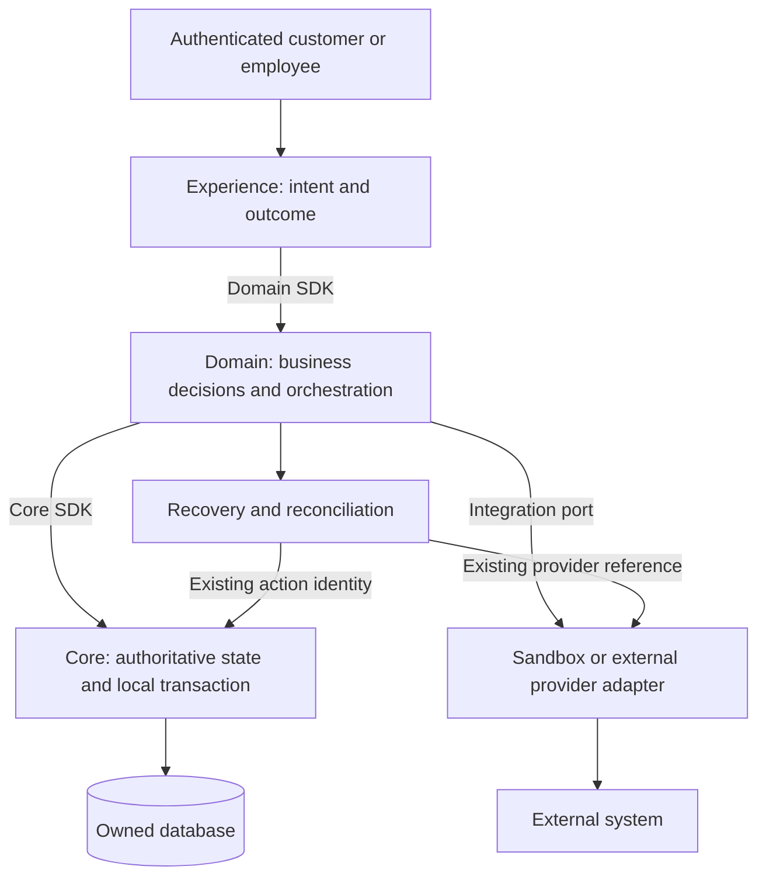

# Architecture

OpenPlatform separates channel journeys, business orchestration, and authoritative state. The boundary matters when eligibility changes, a participant times out, a process restarts, or a financial effect must be reversed.

## Experience

An experience establishes the trusted subject and tenant, validates the requested operation at its channel boundary, calls domain capabilities through SDKs, and presents truthful outcomes. It must not infer permission from a caller-supplied party ID or report success merely because orchestration returned a result object. Staff-assisted operations preserve both employee and represented party authority.

## Domain

A domain owns business decisions and transitions within a bounded context. CQRS separates command intent from queries; a saga coordinates recoverable steps; TCC coordinates participants with explicit try, confirm, and cancel semantics. Use the existing Jafly modules and application conventions. Selecting a pattern does not make cross-service HTTP calls atomic or process-local state durable.

Each step defines preconditions, stable action identity, durable result, retry behavior, compensation, and uncertainty. A business rejection, a failed transport, and a provider-accepted request with a lost response require different outcomes.

## Core

The core owns its records, local constraints, migrations, and atomic database operations. Consumers use its SDK instead of importing its internals or writing its tables. Cross-context links are explicit identifiers with validated ownership and lifecycle. Atomic ledger header/legs/history creation belongs within the ledger database transaction, rather than a sequence of independently committed SDK calls.

## SDK and version contract

Generate a consumer SDK from the actual producer controller contract. Validate required fields, enums, statuses, precision, pagination, optional headers, and errors against a running producer. Publish or install the exact qualified producer before checking dependent consumers. A stale generated client can compile while losing required business input.

## External authority and recovery

An adapter translates a port; it must not hide unsupported capabilities or synthesize approval after failure. Store provider references and business association in the responsible durable authority. Reconcile uncertain outcomes before retrying. The [integration guide](../adapters/index.md) defines sandbox replacement and live-provider gates.

## Read the detailed boundaries

- [Domain architecture](domain.md) and [core architecture](core.md).
- [Libraries and Jafly](libraries.md), including dependency ownership.
- [Business journeys](../journeys/index.md), including operational banking and insurance financial effects.
- [Operating procedures](../operations/index.md), including restart, replay, reversal, and repair.
- [Service landscape](bian.md) and [insurance mappings](acord.md), which are analysis references rather than implementation acceptance.
