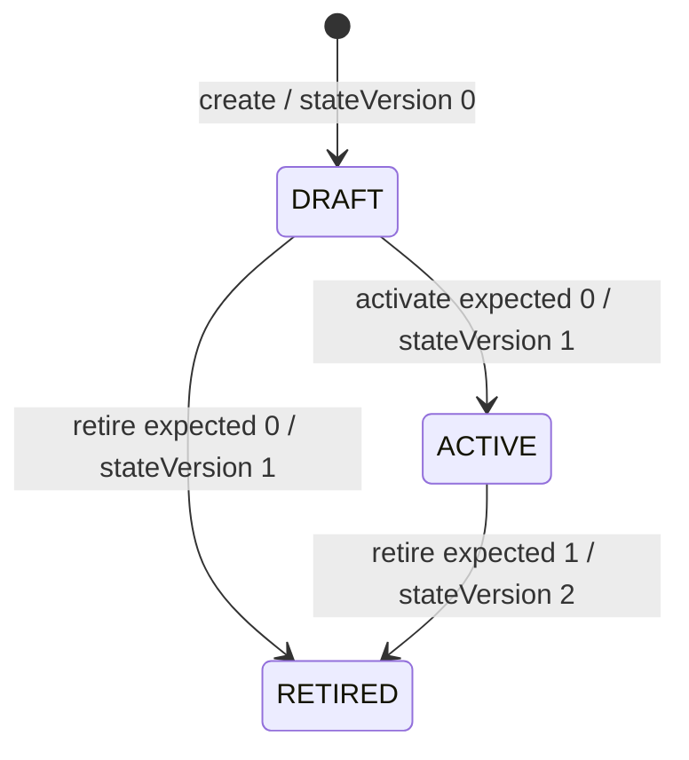

# Document issuer revisions

Document issuer revisions retain a tenant-owned snapshot of the legal display name, registered address, public contacts and exact asset-pack reference approved for future document composition. They keep that authority separate from mutable tenant branding and contact settings.

This API approves display declarations and reference metadata. It does not verify legal registration, address deliverability, contact reachability, asset bytes, fonts, licensing or a rendered document. Publishing a template or activating an issuer revision does not by itself produce branded HTML or a service PDF.

## Workflow and exact selection

1. A trusted administrator submits an immutable draft with a caller-generated action UUID. Configuration generates the revision UUID and retains canonical bytes, digest, creation actor and epoch-millisecond time.
2. Activation approves that stored definition and its exact deployment-recognized pack reference. The policy receives the stored country, profile/version, locale, jurisdiction, pack tuple and digest before the transition.
3. A composer resolves the complete active identity. Resolution requires an operational tenant and a currently recognized pack reference. There is no latest-version, locale or jurisdiction fallback.
4. Retirement stops new resolution while preserving the definition, approval and action evidence. A retired revision cannot be edited, reactivated or deleted.



Revision identity is `(tenant UUID, profileCode, version, localeCode, jurisdiction)`. Localized or jurisdiction-specific variants may reuse a version. Other exact identities may coexist ACTIVE; activation does not silently replace one. Creating the same identity with another action conflicts rather than adopting it.

All mutations use the issuer-only `(tenant, actionId)` namespace across create, activate and retire. Replay compares the complete original intent, including target, expected version and retirement reason where applicable, and returns the **current** retained view. An accepted activation replay can therefore return RETIRED. Replay never renews approval, rewrites actors/times, or appends duplicate history. A changed action intent conflicts 409. The namespace is separate from existing document-template binding actions.

## Native API

Base path: `/api/v1/document-issuer-revisions/tenants/{tenantId}`.

| Method/path | Operation | Request |
| --- | --- | --- |
| POST base | `createDocumentIssuerRevision` | actionId, profileCode, version, definition |
| GET `/{revisionId}` | `getDocumentIssuerRevision` | Exact tenant/revision |
| POST `/{revisionId}/activate` | `activateDocumentIssuerRevision` | actionId, expectedStateVersion |
| POST `/{revisionId}/retire` | `retireDocumentIssuerRevision` | actionId, expectedStateVersion, reason |
| GET `/resolve` | `resolveDocumentIssuerRevision` | All four selection query fields: profileCode, version, localeCode, jurisdiction |

Success returns200 with a typed `DocumentIssuerRevisionView`, including canonical text/digest, definition, state version and retained lifecycle actor/time/action metadata. New transitions accept expectedStateVersion0..1; accepted replay uses its original expected value, not the subsequently incremented state version. Resolution and mutations are not generic CRUD.

Errors:400 malformed/unsupported input;403 current trusted permission denied;404 exact tenant/revision/selection absent;409 immutable action or identity conflict, stale lifecycle/version, inactive/ineligible resolution or unrecognized pack;503 no configured pack registry for new use. Historical GET, accepted replay and authorized retirement remain available for an inactive tenant. New create/activation and active resolution do not.

Each native mutation opts out of transport idempotency caching. A compatibility header cannot replace current authorization, business action identity or retained state. Existing V1 binding, branding and tenant APIs keep their contracts.

## Generated Java SDK

The producer generates `DocumentIssuerRevisionsApi` and typed command/definition/view models in the existing configuration SDK. Supply the current validated deployment bearer in a per-call client; do not mutate a shared client's authorization header between tenants.

```java
var client = new ApiClient().setBasePath(configBaseUrl);
client.addDefaultHeader("Authorization", "Bearer " + currentDelegatedBearer);
var issuers = new DocumentIssuerRevisionsApi(client);

Mono<DocumentIssuerRevisionView> retained =
    issuers.getDocumentIssuerRevision(tenantId, revisionId, null);
Mono<DocumentIssuerRevisionView> selected =
    issuers.resolveDocumentIssuerRevision(
        tenantId, "STATEMENTS", 1, "en-US", "US", null);
```

`ApiClient` is in `io.fireflysoftware.common.config.sdk.invoker`; the API/model packages are `io.fireflysoftware.common.config.sdk.api` and `.model`. The final nullable read parameter is a compatibility header, not identity or permission. The current framework's transport cache applies only to mutations; reads still evaluate current issuer policy and exact resolution eligibility. Native mutation methods accept their typed command without a transport idempotency header. Retain the original command's action UUID/intent for a retry rather than generating another action. Compare `getCanonicalJson()` as exact text and use `getDefinitionDigest()`/`getCanonicalizationVersion()` together; epoch-millisecond actor metadata has no local-time-zone ambiguity.

## Definition contract

Create accepts exactly actionId, profileCode, version and definition. Version is a literal positive JSON integer 1..2147483647; fractions, exponent tokens, strings, booleans and overflow are invalid. Unknown and duplicate fields are rejected locally, including in nested objects. Activation and retirement decode their expected version with the same exact integer rules. The resolve version query uses positive decimal digits only.

```json
{
  "actionId": "9f28fb50-e50f-49c4-aab8-6ce5ecf1eb47",
  "profileCode": "STATEMENTS",
  "version": 1,
  "definition": {
    "legalName": "Northbridge Example Bank",
    "tradingName": null,
    "registrationAuthority": null,
    "registrationNumber": null,
    "registeredAddress": {
      "lines": ["100 Example Avenue", "Example City"],
      "countryCode": "US"
    },
    "publicContacts": [
      {"purpose": "SERVICE", "channel": "EMAIL", "value": "service@example.invalid"}
    ],
    "localeCode": "en-US",
    "jurisdiction": "US",
    "assetPack": {
      "packId": "INSTITUTION_STATIONERY",
      "version": "1.0.0",
      "manifestDigest": "0123456789abcdef0123456789abcdef0123456789abcdef0123456789abcdef"
    }
  }
}
```

The example is fictional; its pack tuple must be deliberately recognized by the deployment before use. A syntactically valid digest does not establish an installed pack.

| Field | Bound/meaning |
| --- | --- |
| profileCode | `[A-Z][A-Z0-9_]{0,63}` |
| legalName; optional tradingName | 1..256 Unicode characters each |
| registrationAuthority/registrationNumber | Both null or both present,1..128 each |
| address lines | 1..4 lines,1..128 characters per line |
| countryCode | Two uppercase letters; syntax only |
| publicContacts | 1..6, unique `(purpose,channel)`, input order preserved |
| purpose/channel | SERVICE/COMPLAINTS/CLAIMS and EMAIL/PHONE |
| contact value | 1..256 raw display characters; no delivery assertion |
| localeCode | Exact language-tag syntax accepted by Java `Locale.Builder`,1..50 characters; private-use and grandfathered tags remain supported |
| jurisdiction | `[A-Z][A-Z0-9_-]{1,49}` |
| packId/version | `[A-Za-z0-9][A-Za-z0-9._-]{0,63}` |
| manifestDigest | Lowercase64hex SHA-256 |
| retirement reason | 1..500 Unicode characters |

Character limits count Unicode code points. Text rejects blank values, boundary whitespace, ISO controls and unpaired surrogates. Valid interior text is preserved without trimming, case folding or Unicode normalization. Optional empty strings are invalid. Display declarations are raw text, not HTML-escaped input; a future renderer must escape once in its own output context. No caller URL, path, CSS or font resource is accepted.

## Canonical authority and retained storage

The named canonicalization algorithm is `CONFIG_DOCUMENT_ISSUER_V1`. Its root is exactly `{definition,profileCode,version}` with recursively sorted declared keys, explicit optional nulls, preserved array order and a plain integer version. JSON is compact literal UTF-8 with standard quote/backslash escaping, no HTML/slash escaping and no normalization. The digest is lowercase SHA-256 of `CONFIG_DOCUMENT_ISSUER_V1`, one LF, and those exact canonical bytes. This is a named business profile, not a claim of RFC8785 conformance.

Canonical text is bounded to 16384 UTF-8 bytes and stored as TEXT, separately from parsed JSONB inspection. The request decoder independently caps raw JSON at32768 bytes. The returned canonical String is the exact retained value. The definition digest is intentionally tenant-independent; the immutable action intent separately binds tenant, kind, target, expected version and reason/digest.

The V6 migration adds revision, action, history and outbox records. Tenant/row/action serialization, lifecycle CAS and native guards keep the definition, actor/time and action evidence immutable and commit transition evidence atomically. Tenant deletion is blocked by retained foreign keys. Later edits to legacy tenant/branding metadata do not rewrite the snapshot. These are ordinary application integrity controls, not a boundary against a database administrator.

## Trusted policy and pack configuration

The deployment supplies the existing framework `SecurityContextPort` and `PolicyDecisionPort`. Without trusted ports or a granted obligation-free decision, issuer operations deny. Policy actions are `config.document-issuer.create/read/activate/retire/resolve` over the exact tenant/revision or complete selection. Cross-tenant delegation additionally requires trusted `config.document-issuer.delegate` authority and an exact tenant entry in `documentIssuerTenants`; a caller header or action body is not that authority.

Coarse tenant/revision authorization runs before database access. Stored approval/read/replay then uses a safe immutable selection context: profile/version, locale, jurisdiction, country, exact pack tuple and canonical digest. Address/contact body text is not placed in policy diagnostic context. Policy evaluation does not hold the local SQL mutation transaction open.

The local `DocumentIssuerAssetPackRegistry` recognizes closed metadata tuples. Its default implementation reads deployment configuration and has no asset URLs, bytes or unconditional fallback:

```yaml
firefly:
  documents:
    issuer:
      asset-packs:
        - pack-id: INSTITUTION_STATIONERY
          version: "1.0.0"
          manifest-digest: "${APPROVED_STATIONERY_MANIFEST_SHA256}"
```

The environment value must be the approved lowercase 64-character hexadecimal digest. New create/activation/resolution require exact recognition. Empty configuration is unavailable 503; an unknown tuple is 409. Retirement, historical read and accepted identical action replay do not require registry availability. Removing a tuple prevents new use but does not erase historical authority. A future composer must independently verify its own approved asset bytes and rendering profile before issuance.

## Verification

Normal compatibility verification uses `mvn -DskipOpenApiGen -Dcodegen.skip=true verify` with the project's configured Java/Maven environment. Genuine producer generation and the regenerated SDK are a separate controlled build, using the normal inherited producer profile. Tests cover independent canonical vectors, exact decoding, actual private PostgreSQL integrity/lifecycle/rollback, trusted policy/current replay, and packaged HTTP warm-cache/restart behavior. The synthetic signed deployment used by integration tests is test-only and supplies no production institution approval.
