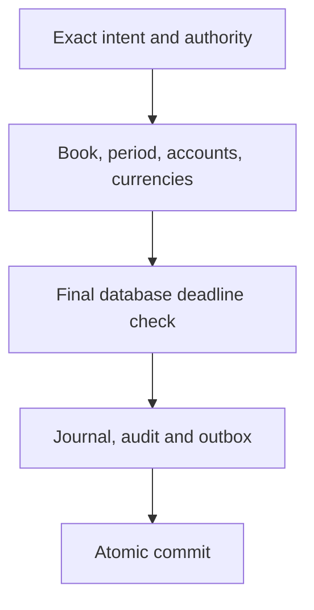

# Atomic journal intent and admission

The GL foundation retains exact journal intent and enforces native storage invariants. Protected financial command APIs, administrative receipts, source-to-GL adapters and accounting consumers remain required integrations. A native SQL journal test does not establish a completed banking, insurance or IFRS process.

## Keep the authorities distinct

Masters publishes exact currency representations. GL retains admitted representations, books, posting accounts and accounting periods. Current actor, book and individual account authority must be established before the local transaction. Neither a currency code nor a digest alone authorizes money movement.

Each journal entry balances within its exact admitted representation. Positive canonical minor-unit strings avoid floating-point conversion and implicit rounding. Complete original request bytes, source identity, actual row membership, expected versions and currency references remain bound to one immutable intent.

## Admit after acquiring the real gates

Admission completes only after the action statement acquires the actual book, period, sorted posting-account and sorted currency gates, checks their exact retained versions, and passes the final database clock and current-authority checks. An INSERT attempted before waiting is not an admitted operation. If the wait crosses the original request cutoff, the operation is rejected without journal effects.

Locks remain held until transaction completion. Work admitted before the cutoff may finish its complete economic rows and commit afterward. This does not extend the separate finite authority lifetime. Deferred completeness checks still require the posting, lines, audit and outbox to belong to the same transaction and exact original intent.

## Recover from authoritative evidence

Retain stable action identity and the complete original request. A timeout, missing response or ordinary not-found result cannot prove that no financial effect exists. Reconciliation requires its own current authority and retained exact-intent outcome. Suspended admission must not force financial reactivation merely to read existing authorized history.

Use separate migration and restricted runtime roles, strict current policy and transaction-local context on the actual connection. External approval, policy and SDK observations occur outside SQL transactions. Missing configuration must deny rather than silently select the latest currency policy or approve an unknown source.

The [service-owned accounting guide](https://github.com/fireflysoftwaresolutions/core-common-accounting-gl/blob/fa607c88ed5107939bd307995fd182a3aa0a740c/docs/atomic-accounting-owner.md) provides exact configuration, role prerequisites, canonical request rules and legacy migration limits. Read it with [managed funds](managed-funds.md) and [durable internal payments](managed-payments.md). Financial source projection, reversals, reconciliation, reporting and IFRS calculations remain separate required deliveries.
