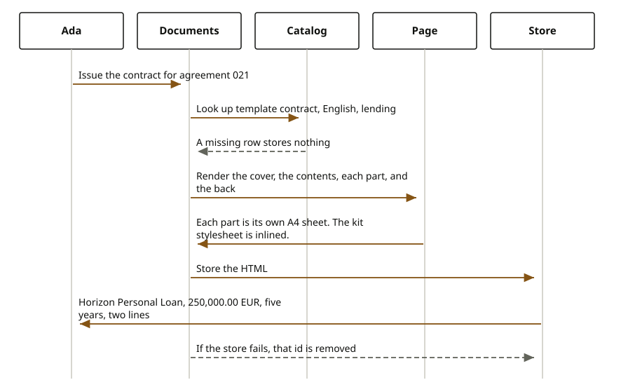

# Documents

When an agreement exists, someone still has to hand the customer a page she can keep. That page is not the agreement record itself. The agreement stays in the contract store. The document is a reading copy: who the parties are, which product it is, the amount, the term, and the lines on it. A letter and a welcome do the same job in a shorter layout. An amendment and a renewal are reading copies that name the agreement they follow.

The sandbox customer is Ada Lovelace. She is the account holder. The sandbox agreement is `10000000-0000-4000-8000-000000000021`. The product on that agreement is Horizon Personal Loan. The term is five years, from November 1, 2026 through November 1, 2031.
Source: the sandbox sample prints 250,000.00 EUR. It was issued on October 20, 2026, and its status on the sample is Issued. The agreement has two lines. The first line is the principal, and it is the primary line. The second line is credit protection, and it is not primary.

Five kinds of document can be issued. A contract is the long reading copy of the agreement. An amendment is the long copy of a change, and it names the predecessor agreement `10000000-0000-4000-8000-000000000020` and states what changed. On the sample, the change is that the term now ends on November 1, 2031. A renewal is the long copy that continues that same predecessor. A letter is the short confirmation. A welcome is the short note that onboarding is complete and that this agreement records the Horizon Personal Loan for Ada. Those are the only kinds. The catalog does not issue any other layout.

<div class="ff-journey" markdown="0">

</div>

Issuing the contract starts with the catalog. The request asks for template `contract`, in English, for a lending product, and it says the product is regulated. The catalog row has to match those facts, and the template code on the row has to be `contract`. The page is then rendered. The kit stylesheet, `document.css`, is written into the HTML. It is not linked as a separate file the reader has to fetch. Fonts are inlined the same way. On screen, the contract is a stack of A4 sheets. The cover is one sheet. The contents are the next sheet. Each part after that is its own sheet: parties, product, amount, term, and the two contract lines. The back page is its own sheet. An amendment and a renewal use the same sheet split. A letter and a welcome are shorter, and they still use the same inlined kit stylesheet.

The stored result is HTML, media type `text/html;charset=UTF-8`. A later read returns the document id, the template code, that media type, and the HTML. The sample file for the contract is the rendered contract in the document module. This page does not paste it.

## What can go wrong

A template the catalog does not have, or a row that is not active, or a row whose language, product family, regulated flag, or template code does not match the request, fails before anything is stored. The caller is told that nothing was stored.

An amendment or a renewal that does not name the predecessor agreement fails before render. An amendment that does not state what changed fails the same way. A currency that is not three letters, a missing party name, a missing agreement, or a document with no lines fails before the catalog is asked to render.

If the render is empty, nothing is stored. If the store accepts an id and then fails, that id is removed, so a later read does not return a half-written document.

## Reference

The call is issue, then read.

```text
// Issue the sandbox contract
{
  // templateCode: contract
  // language: en
  // productFamily: LENDING
  // regulated: true
  // party.id: 11111111-1111-4111-8111-111111111111
  // party.givenName: Ada
  // party.name: Ada Lovelace
  // party.role: Account holder
  // contract.id: 10000000-0000-4000-8000-000000000021
  // contract.status: Issued
  // product.id: 10000000-0000-4000-8000-000000000202
  // product.name: Horizon Personal Loan
  // currency: EUR
  // amount: 250000.00
  // issuedOn: 2026-10-20
  // effectiveOn: 2026-11-01
  // endsOn: 2031-11-01
  // lines[0]: id ...221, role Principal, quantity 1, primary true
  // lines[1]: id ...222, role Credit protection, quantity 1, primary false
  // predecessorId: absent on a contract
}
// An amendment or a renewal sets predecessorId to
// 10000000-0000-4000-8000-000000000020
// An amendment also sets change to
// The term now ends on November 1, 2031.
```

The five catalog codes are `contract`, `amendment`, `renewal`, `letter`, and `welcome`. The type names behind the call are `DocumentPort` and `IssueDocument`. The default catalog reader, the FreeMarker render, and the sandbox store are the adapters an installer can replace. `firefly.documents.storage=core` writes the HTML into the document core. `firefly.reference-data.catalog.adapter=core` reads the catalog from reference data. The stylesheet file that is inlined is `document.css`. `sheets.css` is the screen rule that gives each part its own A4 sheet.
