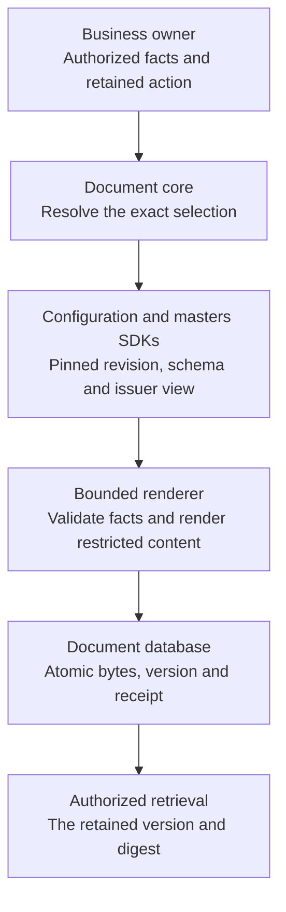

# Documents: content, records, and signature evidence

A contract record describes an agreement. A rendered document expresses one version of its terms. A document receipt identifies retained bytes, their source and their business resource. Signature evidence and delivery evidence are separate results. Creating metadata, issuing content, signing it and delivering it must never be presented as the same completed operation.

## Choose the implemented path

| Path | Current behavior | Integration boundary |
| --- | --- | --- |
| Governed document producer | Exact configuration/master selection, schema validation, restricted HTML, immutable bytes/version/receipt/facts/retention in one local transaction | Genuine core SDK; deployment-provided trusted policy and authoritative facts required |
| Governed contract producer | Signed ownership enrollment, native source snapshot, sealed typed facts, independent issuance/content verification and atomic immutable attachment | Contract core SDK; domain collection from actual customer/product owners remains a dependent integration |
| Approved issuer definitions | Tenant-owned legal display declarations, exact canonical definition, recognized asset-pack reference and immutable approval/retirement history | Configuration SDK metadata authority; controlled composition must explicitly bind the approved revision |
| Legacy sandbox generation library | Explicit sandbox selectors and supplied Java-model facts | Local development facility; not an implicit fallback or the governed HTTP contract |
| Kit-document endpoint | Existing contracts-domain path creates metadata and does not return generated content | Authoritative contract facts, durable issuance/attachment and consumer migration are in progress |
| Managed legacy signature | Durable synthetic provider request and lifecycle for its supported existing documents | New governed bytes reject this path until signing binds the exact content version/digest |

These are current source capabilities. Match the producer and generated SDK; a local source snapshot is not a published release. Start with [template configuration](template-configuration.md), then use the [complete governed issuance guide](../reference/service-guides/governed-document-issuance.md) for exact fields, routes, trust, storage and recovery.

## Keep ownership explicit

Masters owns reusable wording, closed schemas and immutable localized template revisions. Configuration owns exact tenant, purpose, product scope, channel, jurisdiction, locale and effective-time bindings. Document core consumes both actual SDKs and owns issuance/content/version/retention. Business services own amounts, dates, parties, coverage and decisions. Domains collect those facts and coordinate genuine producer SDKs; they do not import another core's repositories.

A retained template is not an approved business decision. An invoice is not payment evidence. A policy illustration does not establish coverage. A generated agreement does not disburse money or prove consent. Each owning journey must establish those prerequisites and provide the appropriate source references.



This is the content pipeline. The remote source checks are observations; only the document aggregate commits in its own local transaction. Signing, attachment and delivery keep their separate authorities.

## Prepare an immutable request

The governed route base is `/api/v1/document-issuances/tenants/{tenantId}/resources/{resourceType}/{resourceId}`. Use the genuine `GovernedDocumentIssuanceApi`, whose input is a typed `DocumentIssueRequest`.

| Request part | Meaning |
| --- | --- |
| `actionId` | Stable tenant-scoped business issuance identity, retained before the remote effect |
| `definition.selection` | Exact purpose, NONE/EXACT product scope, channel, jurisdiction, locale and business epoch |
| `definition.expected` | Resolved binding ID/state version and exact master revision/source digest |
| `definition.factsContract` | Exact code/version and ordered authoritative source observations |
| Display/type/classification | A real ECM type, explicit display name and at least CONFIDENTIAL classification |
| Retention | Recognized deployment policy/version and explicit retained-until epoch |
| `factsJson` | One exact UTF-8 JSON serialization matching the published schema |
| Optional predecessor | Retained issuance under the same tenant/business resource for a new correction |

Resource IDs use canonical lowercase UUID strings; the type is an exact uppercase code. Trusted policy validates the actual stored business resource. A body ID, tenant header, party ID or account number is not authority.

Resolve and pin deliberately through configuration. Document core independently resolves the exact selection, verifies the master strings/digests, validates facts and checks eligibility again before persistence. There is no latest-version, locale, jurisdiction or sandbox fallback. The observations span separate services; they are not an atomic cross-service issuance grant.

Epoch values retain exact milliseconds within the supported 1900–9999 UTC range. Facts stay a string throughout SDK transport. Their raw UTF-8 digest uses `JSON_UTF8_EXACT_V1`: whitespace and key-order changes are different intent. Preserve the original serialization rather than rebuilding it through a generic map that could round a large integer or decimal.

## Issue, retrieve and recover

`issueGovernedDocument` returns200 for both the first issuance and an identical retained replay. The local transaction claims the action and stores the document, version1, actual bytea content, facts, receipt and retention association. Concurrent identical calls converge on the committed identity. Changed intent returns409. A worker, upstream or database failure rolls back the local aggregate.

`getGovernedDocumentIssuance` retrieves retained receipt/provenance without exposing raw facts. `getGovernedDocumentContent` returns the exact UTF-8 content, version ID, media type, byte length and SHA-256 digest. Verify those values before presenting a downloadable document. Existing exact document/version/download SDK operations can retrieve the same retained bytes under their current access requirements.

The [complete reactive Java example](../examples/GovernedDocumentIssuanceExample.java) calls the genuine SDK with an already retained request, retrieves the content and checks issuance/version, exact UTF-8 length, media type, content digest and facts digest. Supply a configured authenticated client and actual authorized resource IDs. The helper does not create a business journal or establish legal authenticity; its timeout can follow an already committed issuance, so recovery must reuse the same request/action.

```java
return GovernedDocumentIssuanceExample.issueAndRead(
    documentsApi, tenantId, resourceType, resourceId, retainedIssueRequest);
```

After a lost response or process restart, retry the original sealed request and action. The retained replay does not re-render or require current upstream availability. Current issue/retention permission still applies; historical content uses its current read policy. Retirement prevents new selection while preserving retained evidence.

Native issuance bypasses the HTTP response cache so an old successful response cannot replace those current checks. The optional `X-Idempotency-Key` remains in this operation's SDK signature for compatibility and is ignored. Preserve the actual business `actionId` and exact sealed request; a transport key is not durable document identity.

A correction creates a new document/version1/receipt linked to its predecessor. It never replaces previously issued bytes. If a later contract attachment or delivery fails, retain the issued evidence and recover that association; do not compensate by deleting the document.

## Configure trust and service access

Every governed operation requires deployment-provided Jafly `SecurityContextPort` and `PolicyDecisionPort`. Missing trusted adapters deny403. Issuance requires current issue/retention permission and fact-producer authority. Receipt/content reads have separate permissions. Cross-tenant service use requires explicit signed delegation and a permitting policy; body fields cannot grant it.

Configure both `firefly.documents.governed.configuration.*` and `.masters.*` with `base-url`, `token-uri`, `client-id`, `client-secret` and `scopes`. Supply values through deployment configuration and secrets. Use HTTPS; `allow-loopback-http` is an explicit private development option. Each downstream call uses a separate service client-credentials identity and genuine generated SDK. Missing configuration returns503; it never substitutes a local template.

Retention permission must recognize the exact requested policy/version/date. A generic tenant retention setting is not a legal policy registry. Current immutable storage is separate from a complete hold/purge scheduler or jurisdiction-specific retention approval.

## Understand the current rendering profile

`GOVERNED_XHTML_V1` uses Jafly's restricted JSON-only FreeMarker renderer and offline schema engine. Templates can express conditions, repeated rows and escaped financial text. They cannot supply arbitrary classes/objects, scripts, imports, external assets or CSS. Published `styleContent` must be empty. The server adds its typed issuer/color/font view and restrictive wrapper; a font-family display value does not establish an embedded licensed font.

Rendering and schema work run in bounded private child JVMs with a parent deadline, bounded concurrency and size limits. Heap/wall-time bounds are not an OS CPU/RSS isolation claim. The source guide specifies the exact operational limits and supported schema profile.

Official-logo/font stationery and professionally paginated PDFs require a separate controlled output profile with pinned assets, issuer details, approved clauses and retained rendering provenance. The masters-owned `sandbox/documents` collection supplies substantive financial examples and an offline A4 design preview. Its print stylesheet is not supported arbitrary author CSS, and browser-printed specimens are not a service PDF API. Variable-length production content needs measured overflow rejection or qualified pagination, repeated headings and truthful page numbering.

The [financial stationery tutorial](financial-stationery.md) shows the designs, maps each document to its own facts contract, and explains publication, binding, issue/readback, local preview and project replacement.

## Approve an issuer for controlled composition

The configuration issuer API keeps a retained legal display definition separate from mutable tenant branding. Its definition contains the legal/trading names, optional registration pair, registered address, public service/complaint/claim contacts, exact locale/jurisdiction and approved asset-pack tuple. These are raw display declarations; the renderer must escape them in its output context.

Create a draft, inspect its canonical text and digest, activate that exact definition, and resolve the complete tenant/profile/version/locale/jurisdiction identity. There is no latest-version or locale fallback. Retirement prevents new resolution and preserves the original definition and approval. Identical action replay returns the current retained lifecycle; replaying an activation cannot reactivate a retired definition.

The [issuer setup and generated-SDK guide](../reference/service-guides/document-issuer-revisions.md) includes the typed request, field bounds, lifecycle, canonical algorithm, trust/delegation rules and environment-backed pack registry configuration. The registry recognizes exact metadata; it neither loads remote assets nor proves the pack is installed. Current new use requires recognition, while authorized historical reads and accepted replay retain their evidence if registry configuration later changes.

## Publish a layout with exact legal notices

Masters can atomically publish a new localized source revision with its immutable layout association, recognized profile metadata and ordered legal-notice references. The source is created in the same transaction; an existing committed source cannot be adopted. GENERAL_DISCLOSURE is required in the footer. Optional PRIVACY_NOTICE, COMPLAINTS_NOTICE and SIGNATURE_NOTICE use body-note placement. Every notice pins a real immutable revision in the same exact locale, with content/schema/style/source digests and an empty-facts schema.

The [layout publication tutorial](../reference/service-guides/document-layout-publications.md) explains authority, empty-by-default profile recognition, draft observation, complete request construction from real API responses, new publication and replay, retirement and recovery. A repeated accepted action rechecks current authority and returns its current lifecycle; historical reads retain canonical source/profile/notice evidence. Metadata recognition does not install CSS, logos, fonts or a PDF engine.

An approved issuer is one input to the controlled composition path. The current restricted-HTML issuance profile does not implicitly adopt it. Exact tenant layout/issuer/profile binding, verified packaged assets and qualified HTML/PDF composition remain separate implementation stages. The published notice associations must be explicitly consumed by that composition path. An activated issuer definition alone cannot change an already issued document.

## Preserve ECM compatibility deliberately

Governed documents cannot be changed through legacy upload/update/version/delete or sidecar routes. Ordinary legacy collections exclude governed rows before pagination/count. Exact reads still authorize the retained parent, tenant and business resource. Metadata/tag/permission and indirect signing operations follow the same association checks.

The content-metadata GET remains `/api/v1/documents/{documentId}/metadata`. The separate metadata-entry collection is `/api/v1/documents/{documentId}/metadata/entries/list`; use the regenerated SDK for this route. A missing exact version under the wrong parent is not a successful empty document.

Legacy synthetic signature history remains intact for its supported document family. New governed documents reject old signature submission because it lacks exact version/digest binding. `ISSUED` never means `SIGNED` or `DELIVERED`. The future provider bridge must bind authorized signer/recipient, retained bytes, action and provider reference, then recover accepted requests and authenticate/deduplicate callbacks.

## Complete business facts and kits

The contract core now provides a separate governed producer. First bind the real contract to its tenant through an exact signed ownership attestation and current policy. Prepare a stable action against its native business-source revision. Seal complete typed customer/product/master observations with the captured parties, lines and terms. The core retains the exact private `DocumentIssueRequest`; an authorized domain consumer sends that request through the document SDK, then asks contract core to record the candidate issuance ID. Contract core independently reads the receipt and actual content, verifies identity, intent, provenance and byte digest, and atomically attaches the immutable version.

The [contract producer guide](../reference/service-guides/governed-contract-documents.md) specifies the seven SDK operations, ownership tuple, exact facts contracts, term types, bounded canonical JSON, delegated service configuration and recovery. Metadata reads never return the private facts. First sealing conflicts after a source change; already sealed intent remains historical evidence. If issuance succeeds and attachment fails, retain and recover the issued version. Issuance, recording and attachment are separate local transactions with current authority at each boundary.

The existing domain `KitDocumentService` still accepts a small metadata-oriented request and has an empty-content gap. Some callers pass party, loan-application or policy identities in a field named `contractId`. Those identities cannot silently become contracts. Migrating those callers requires actual owner association, authorized source collection, the governed producer SDK and truthful intermediate results. The existence of the core producer does not complete that domain migration.

`CONTRACT_DOCUMENT_V1` is distinct from statement, loan agreement, policy, premium invoice and claim-settlement facts. Each needs an explicit authoritative mapping and actual source-owner association. Experience code should receive truthful pending/ready/failed states only after that complete SDK path exists. The [shared journeys](../journeys/shared.md), [adapter contract](../adapters/index.md) and [recovery guide](../operations/index.md) explain these cross-service boundaries.
