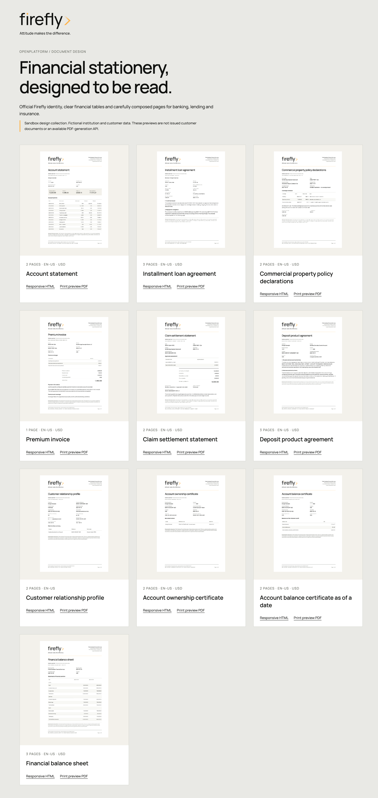

# Financial stationery: author, configure, and issue

A statement, product agreement, customer profile, certificate, financial report, policy, invoice, and settlement explanation have different readers, facts, and business consequences. Start with the document's purpose, then define its source data and wording before choosing a layout. The masters-owned sandbox collection provides concrete American English examples for that process.



*Offline design specimens with fictional institution and customer data. The supported document service issues restricted HTML bodies. The illustrated logo, embedded font, A4 frame, and PDF pagination belong to the separate authoring preview; they are not a selectable service output profile.*

## Find the source of each visible element

| Element | Owner | What to retain |
| --- | --- | --- |
| Clauses, labels, schema, localized body | Masters | Exact published revision, locale, source and schema digests |
| Tenant/product/purpose/channel/time selection | Configuration | Exact binding and state version, explicit product scope and jurisdiction |
| Balances, repayment terms, coverage, assessments | The relevant banking, lending, or insurance service | Authorized source identity/version, calculation policy and sealed facts |
| Issued content and retention | Document core | Original action, exact request, receipt, bytes, version, digest and retention |
| Logo/font/frame in the current preview | Masters-owned preview asset pack | Unchanged official assets, font license, asset manifest and layout source |
| Approved institution details and legal wording | The implementing institution's approval process | Deliberate approved values and versioned wording; no inferred license or approval |

The Firefly logo identifies the platform design. A deployed issuer's legal identity must be explicit and approved. A logo, registration number, unsigned execution field, or legal note is not evidence of a license, signature, consent, coverage, or payment.

## Select a document-specific facts contract

The collection is in `core-common-reference-master-data/sandbox/documents`. `catalog.json` connects each restricted template to its closed schema and fictional example. The following contracts are distinct; do not pass the generic `CONTRACT_DOCUMENT_V1` snapshot to them without an explicit business mapping.

| Catalog code | Facts contract | Important source checks |
| --- | --- | --- |
| `SBX_BANK_ACCOUNT_STATEMENT` | `ACCOUNT_STATEMENT/1` | Statement period, ordered booked movements, opening plus credits minus debits equals closing; do not confuse booked balance with available funds |
| `SBX_LOAN_AGREEMENT` | `LOAN_AGREEMENT/1` | Approved terms, calculation/rounding policy, due dates, each installment's principal/interest and exact final payoff |
| `SBX_INSURANCE_POLICY_DECLARATIONS` | `POLICY_DECLARATIONS/1` | Exact effective policy/product/wording versions, coverage codes, limits, deductibles, premium and tax |
| `SBX_INSURANCE_PREMIUM_INVOICE` | `PREMIUM_INVOICE/1` | Itemized charges, taxes, allocations and remaining amount; an invoice does not establish premium collection |
| `SBX_INSURANCE_CLAIM_SETTLEMENT` | `CLAIM_SETTLEMENT/1` | Exact policy/coverage and loss dates, approved assessment, applicable deductible, depreciation and prior payments; calculated remainder is not a payment receipt |
| `SBX_DEPOSIT_PRODUCT_AGREEMENT` | `PRODUCT_AGREEMENT/1` | Exact contract, customer/account association, approved product, pricing and wording snapshots, execution conditions and retention; an unsigned proposal does not activate an account or assess fees |
| `SBX_CUSTOMER_PROFILE` | `CUSTOMER_PROFILE/1` | Exact customer identity, purpose, authorized masked contact and source versions; an internal profile is not identity verification or consent evidence |
| `SBX_ACCOUNT_OWNERSHIP_CERTIFICATE` | `ACCOUNT_OWNERSHIP/1` | Effective account-holder association, account status, issue purpose and source observation; operator access does not establish legal ownership |
| `SBX_ACCOUNT_BALANCE_CERTIFICATE` | `ACCOUNT_BALANCE_AS_OF/1` | Exact historical UTC cutoff and ledger sequence, booked funds, active holds and available cash; credit capacity is distinct from cash availability |
| `SBX_FINANCIAL_BALANCE_SHEET` | `FINANCIAL_BALANCE_SHEET/1` | Entity, period/comparative period, reconciled GL versions, assets, liabilities and equity; both periods must balance and an unaudited specimen is not an approved financial statement |

The examples use exact two-decimal USD strings. They do not define another currency's scale, a production pricing/tax model, or a universal policy rule. The fictional property product applies the highest applicable buildings/contents deductible once per shared occurrence; its claim uses that explicit wording reference. A different policy requires its own rule and facts.

Schemas constrain shape and local field values. The source owner must also establish cross-field arithmetic, chronology, eligibility, ownership, and decisions. Never populate absent source facts with sample values to make a document render.

### Keep source authority distinct from presentation

The deposit agreement belongs to the contract lifecycle and references the exact product and pricing decision used for its proposal. The customer profile belongs to the customer owner. Ownership certificates require effective holder associations from accounts and customer/party identity. Historical balance certificates need a ledger-supported historical extraction at the requested cutoff; reading today's balance is insufficient. Financial balance sheets require reconciled general-ledger classifications and period controls.

The examples carry fictional source identities and versions so that these boundaries are visible. Their existence does not implement those source extractors. Until each owner supplies its authorized, versioned facts, use the collection for sandbox authoring and issuance rather than representing the content as a live customer certificate or approved financial report.

## Publish the restricted content

Use the matching masters service and generated SDK, with trusted authoring policy. Follow the [full revision guide](../reference/service-guides/document-template-revisions.md) for request fields and lifecycle.

1. Read the target environment's active HTML template type and exact active locale. Create `en-US` through the locale API if the authorized environment requires it; retain the returned ID. IDs are environment-specific.
2. Create a draft from the entry's exact code/version, category, display name, template bytes, `text/html`, and schema JSON. Keep `styleContent` empty. With the Java SDK, explicitly call `inputSchema(null)` before `inputSchemaJson(schemaJson)` so the legacy map default does not become a second schema representation.
3. Create the exact active localization using its localized content. Publish that explicit version/locale and retain every returned revision/source/schema/content digest.
4. Resolve that exact published revision and compare the retained bytes and identities. A changed source for an existing publication identity needs a deliberate new version.

Do not publish `preview/profile.css` as template CSS or add an external logo URL to the body. The governed renderer's restricted capabilities remain unchanged. A stylesheet in an authoring pack does not create a service-supported output selector.

## Bind, seal, issue, and retrieve

Follow the [configuration tutorial](template-configuration.md) and [exact binding guide](../reference/service-guides/document-template-bindings.md). Create and activate the tenant-owned binding using its purpose, explicit NONE/EXACT product scope, channel, jurisdiction, locale, effective window and exact published master pins. Use explicit NONE branding for the unbranded restricted-body path; that does not request the illustrated print design.

Before calling document core, the business journey must durably retain its authorized resource, exact facts serialization, stable action, selection/pins, document type and retention request. Resolve deliberately; there is no latest-version, locale or jurisdiction fallback. A timeout can follow a successful commit, so rebuilding facts or choosing a new action is unsafe recovery.

Use the genuine document SDK and the [governed issuance guide](../reference/service-guides/governed-document-issuance.md). The [reactive Java helper](../examples/GovernedDocumentIssuanceExample.java) demonstrates issue/readback and exact version, media, byte-length, facts-digest and content-digest checks with an already sealed request.

After a lost response, reuse that exact action and request. Retained readback identifies the original bytes. A later attachment, signature, or delivery failure does not justify deleting issued evidence. Corrected content needs a new issuance with explicit predecessor lineage.

## Inspect the offline print design

The source collection's README documents its standalone Java rendering helper and Python layout tool. The Java helper uses the actual Jafly schema engine and restricted renderer; it does not publish content. After producing validated fragments in an external work directory, compose the preview from the masters repository root:

```sh
python3 sandbox/documents/tools/layout_previews.py \
  --source sandbox/documents \
  --rendered /absolute/preview-work/fragments \
  --output /absolute/preview-work/site
```

Serve that output locally and inspect screen and print views. Keep generated files and any customer data outside the repository. The tool verifies fragment/asset digests and composes fixed A4 sections with official Firefly SVGs, licensed Manrope, continuation headers, aligned amounts, document/version references, legal demonstration notes, and page-numbered footers.

Check every row, amount, paragraph, page boundary and footer. On a narrow screen the repayment schedule becomes labeled cards while preserving the values. In print it remains a table. Long production inputs need qualified pagination or explicit overflow rejection, repeated headings and truthful page totals; clipping, omitted rows, and tiny-font fitting are not acceptable layout behavior.

## Replace the sandbox deliberately

Create a new approved revision for actual clauses, products and jurisdiction disclosures. Replace fictional issuer details through an implemented configuration contract, rather than embedding a customer's address into a reusable template. Pin official deployment-owned assets and the qualified output profile when that service capability is available.

For each additional family, identify the trigger, recipient, source service, exact facts/schema, monetary and date rules, required sections, locale, retention, correction lineage, and signature/delivery prerequisites. Card statements, payment notices, endorsements, renewal communications, claim decisions and other families require their own implementations. The current collection is a starting set of concrete specimens.

Use [documents and evidence](documents.md) for current capability boundaries, [adapter replacement](../adapters/index.md) for external services, and [recovery and reconciliation](../operations/index.md) for uncertain outcomes. Legal approval, generated content, signature, delivery, funding, coverage, and settlement remain distinct recorded results.
