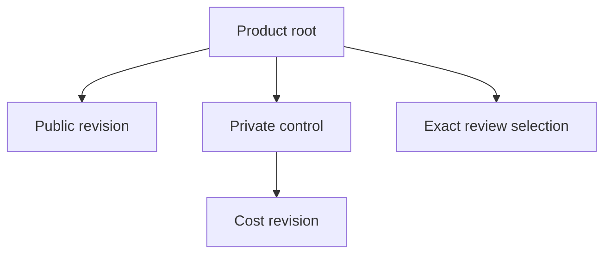

# Governed product definitions

Product Management owns product identity and governed definitions. Domains compose business behavior; finance and insurance terminals expose staff workflows. A product record, a published definition, and permission to originate or issue coverage are distinct decisions.

The current native storage foundation supports typed account tariffs, fixed-rate installment loans and term property insurance. Protected lifecycle APIs, current issuer policy, pricing execution and the terminal wizard remain integration work. Definitions remain **NOT_ADMITTED** for customer offers or financial execution.

## Public terms and private costs

Public terms and internal costs have different immutable revisions, heads, counters, digests and history. Public responses must not disclose costs or reveal their completeness. Submission validates public terms; final approval must validate the exact public/private selection under current authority.

The arrows describe retained references, not completed HTTP operations.

## Storage prerequisites

A deployment administrator must provision the dedicated nonlogin guard role before migration. The migration rejects a missing role, superuser privilege or row-policy bypass. Keep migration and application credentials separate. Native relations force row-level security and deliberately install no runtime allow policies; migration alone does not authorize application access.

A root binds a genuinely new Product inserted in the same transaction with its exact tenant, root and category scope. A committed legacy Product, skipped INSERT or later UPDATE cannot substitute for that birth. Immutable root identities and revisions cannot be reassigned during recovery.

## Commit and retry behavior

Legacy child writes are checked before execution and again after foreign-key synchronization. A child that starts before enrollment commits cannot append or reparent records after the Product becomes governed. Relationship checks cover both endpoints and old/new selections. Propagate failed commits and reread authoritative state before retrying. Do not delete binding/history rows or relax constraints to recover.

Use genuine producer-generated clients when protected lifecycle operations become available. Resolve exact tenant, issuer, product and publication identity. Customer LegalEntity data does not authorize a bank or insurer to issue a product.

The [service-owned storage guide](https://github.com/fireflysoftwaresolutions/core-common-product-mgmt/blob/95e7ea7919067f690664b711f7283fe2d4f92e31/docs/governed-product-definitions.md) details migration prerequisites, supported profiles and recovery. Continue with [currency representation](../reference/service-guides/currency-execution-policies.md) and [governed contract issuance](../reference/service-guides/governed-contract-domain.md).
